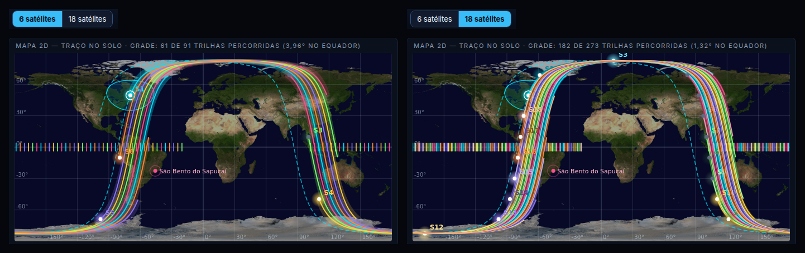
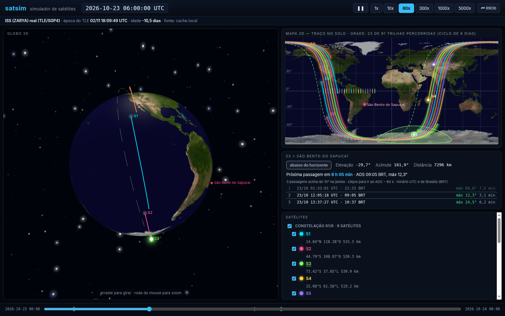

# satsim — simulador de constelação de satélites

[](https://github.com/RenatodaCostaSantos/satellite_constelation_simulation/actions/workflows/ci.yml)
[](https://github.com/RenatodaCostaSantos/satellite_constelation_simulation/actions/workflows/pages.yml)


**satsim** é um simulador de órbitas em Python para projetar e visualizar uma constelação de
satélites de observação da Terra em **órbita heliossíncrona (SSO)**. Ele propaga as órbitas com
as forças relevantes em baixa altitude, calcula cobertura, revisita, passagens sobre uma estação
de solo e custo de manutenção, e mostra tudo num visualizador web com globo 3D e mapa 2D
sincronizados.

**Experimente no navegador:** <https://renatodacostasantos.github.io/satellite_constelation_simulation/>



## Sumário

- [Funcionalidades](#funcionalidades)
- [Instalação](#instalação)
- [Início rápido](#início-rápido)
- [Visualizador](#visualizador)
- [Site estático e publicação](#site-estático-e-publicação)
- [Ferramentas de linha de comando](#ferramentas-de-linha-de-comando)
- [Uso como biblioteca](#uso-como-biblioteca)
- [Validação](#validação)
- [Desenvolvimento](#desenvolvimento)
- [Estrutura do repositório](#estrutura-do-repositório)
- [Limitações](#limitações)
- [Documentação adicional](#documentação-adicional)

## Funcionalidades

- **Propagadores** com a mesma interface `propagate(t) -> (r, v)`, vetorizada:
  - `KeplerPropagator`: problema de dois corpos;
  - `MeanJ2Propagator` e `MeanZonalPropagator`: elementos médios com efeitos seculares de
    J2–J4 e arrasto;
  - `CowellPropagator`: integração numérica com J2–J4, Sol e Lua, pressão de radiação solar e
    arrasto atmosférico;
  - `SGP4Propagator`: satélites reais a partir de TLEs.
- **Projeto de órbita:** inclinação heliossíncrona (analítica e calibrada no Cowell),
  excentricidade congelada, órbita de repetição de traço (91 voltas em 6 dias), conversão entre
  elementos médios e osculadores.
- **Constelações** num único plano com qualquer número de satélites. Os presets são 6 satélites
  (91 trilhas por dia) e 18 satélites (273 trilhas por dia).
- **Análise de missão:**
  - cobertura e revisita por latitude, com e sem luz do Sol;
  - passagens e plano de contatos com uma estação de solo (padrão: São Bento do Sapucaí, SP);
  - deriva do traço e do LTAN, data da próxima correção e Δv anual de manutenção;
  - decaimento orbital e tempo de vida.
- **Satélites reais:** TLEs da [CelesTrak](https://celestrak.org/) com cache local e TLEs
  embutidos para uso sem internet. A ISS e o Sentinel-2A servem de referência de validação.
- **Visualizador web autocontido:** um único arquivo HTML que abre com duplo clique, sem servidor
  e sem internet.
- **Site estático** publicado automaticamente no GitHub Pages.

## Instalação

Requer Python ≥ 3.11. As dependências de execução são `numpy`, `scipy` e `sgp4`.

```bash
git clone https://github.com/RenatodaCostaSantos/satellite_constelation_simulation.git
cd satellite_constelation_simulation
python -m venv .venv
source .venv/bin/activate        # Windows: .venv\Scripts\activate
pip install -e ".[dev]"          # ou: pip install -e .  (sem ferramentas de teste e gráficos)
```

O extra `dev` instala `pytest`, `ruff`, `skyfield` (usado como referência nos testes) e
`matplotlib` (usado só pelos scripts de relatório).

## Início rápido

```bash
python scripts/build_demo.py      # gera demo/index.html (~10 s)
xdg-open demo/index.html          # macOS: open; Windows: dê dois cliques no arquivo
```

A cena gerada cobre as próximas 24 h, com a constelação de 6 satélites, a ISS e o Sentinel-2A.
Para gerar as quatro cenas (6 ou 18 satélites, 1 dia ou o ciclo de 6 dias) ligadas pelo seletor
"6 satélites | 18 satélites":

```bash
python scripts/build_demo.py --all    # ~3 min
```

## Visualizador



O globo 3D e o mapa 2D ficam na mesma tela e sincronizados. Todo o cálculo é feito em Python ao
gerar a cena; o navegador só desenha. Biblioteca, textura e dados vão embutidos no HTML, então o
arquivo abre com duplo clique (`file://`). A rede só é usada ao gerar a cena, para baixar TLEs
recentes, e é opcional.

### Satélites da cena

| Satélite | Propagador | Descrição |
|---|---|---|
| S1 … S6 (ou S1 … S18) | `CowellPropagator` completo | a constelação 91/6 num único plano: a = 6 888,089 km, i = 97,46325°, excentricidade congelada (ω = 90°), LTAN 22h30 |
| ISS | `SGP4Propagator` | a Estação Espacial Internacional, a partir do TLE mais recente; desligada no início |
| Sentinel-2A | `SGP4Propagator` | uma SSO real a ≈ 786 km, para comparação com a órbita de projeto; desligada no início |

### O que a interface mostra

- **Constelação:** com 6 satélites, 60° entre vizinhos, um a cada ≈ 15,8 min; com 18, 20° entre
  vizinhos, um a cada ≈ 5,3 min. A troca entre 6 e 18 abre a cena irmã **no mesmo instante**,
  com a mesma velocidade, as mesmas camadas e o satélite correspondente selecionado.
- **Camada "grade do dia":** cada nó ascendente percorrido vira um traço no equador. O título do
  mapa conta as trilhas (de 91 com 6 satélites, de 273 com 18).
- **Camada "faixa":** a área que a câmera alcança com a rolagem que fecha a grade diária
  (±23,2° com 6 satélites, ±8,18° com 18).
- **Legenda agrupada:** uma caixa liga e desliga a constelação inteira. Com 18 satélites, a
  legenda se divide em três famílias recolhíveis, cada uma equivalente a uma constelação de 6
  deslocada de 1/3 de passo de grade.
- **Painel Informações** do satélite selecionado: latitude, longitude, altitude, LTAN, ângulo β
  entre a órbita e o Sol, iluminação (eclipse esmaece o marcador), fase em relação a S1,
  família, rolagem para cobertura diária, próxima correção do traço e Δv anual de manutenção.
- **Painel da estação** (São Bento do Sapucaí, elevação mínima de 10°):
  - elevação, azimute e distância atuais, com o estado *visível*, *baixo* ou *abaixo do
    horizonte*;
  - contagem regressiva para a próxima passagem;
  - lista de passagens em UTC e no horário de Brasília. Clicar numa passagem leva o relógio a
    60 s antes do AOS, e as passagens aparecem como marcas verdes na linha do tempo;
  - linha estação → satélite no globo e círculo de visibilidade (footprint) no mapa.
- **Faixa do TLE:** época, idade e fonte do TLE, em destaque quando a idade passa de 3 dias.

No mapa, a linha cheia é o traço já percorrido e a tracejada é o futuro. A vista mantém a Terra
fixa (ECEF) e o subponto é geodésico (WGS84). O estado da visualização fica na URL (`#t=…&v=…`),
então um link reabre a cena no mesmo instante.

### Controles

| Controle | Ação |
|---|---|
| ▶ / ❚❚ (ou barra de espaço) | reproduzir / pausar |
| 1x · 10x · 60x · 300x · 1000x · 5000x | velocidade da simulação (5000x: 1 dia em ≈ 17 s) |
| linha do tempo | arrastar para qualquer instante da janela |
| ⏮ início | voltar ao início da janela |
| 6 satélites \| 18 satélites | trocar de constelação no mesmo instante |
| passagem na lista | ir a 60 s antes do AOS |
| caixas na lista de satélites | mostrar / ocultar cada satélite ou o grupo inteiro |
| camadas do mapa | ligar / desligar a grade do dia e a faixa |
| nome na lista de satélites | selecionar o satélite dos painéis Informações e da estação |
| arrastar / roda do mouse no globo | girar / zoom |

### Opções de geração

```bash
python scripts/build_demo.py                # 6 satélites, 24 h a partir de agora (~7 MB)
python scripts/build_demo.py --days 6       # o ciclo de repetição inteiro (~11 MB, ~40 s)
python scripts/build_demo.py --sats 18      # 18 satélites → demo/constelacao18.html (~11 MB)
python scripts/build_demo.py --all          # as quatro cenas, ligadas pelo seletor 6 | 18
python scripts/build_demo.py --offline      # sem rede: cache local ou TLEs embutidos
python scripts/build_demo.py --tle-file tests/data/iss_sample.tle --start tle-epoch   # reprodutível
```

Use `python scripts/build_demo.py --help` para todas as opções. A pasta `demo/` não é
versionada; gere de novo para atualizar os TLEs.

### Adicionar um satélite

Acrescente-o à lista `satellites` montada em `build_demo` de
[`scripts/build_demo.py`](scripts/build_demo.py), como `SceneSatellite(id, nome, cor,
propagador)` com qualquer propagador. Por exemplo, com elementos médios de J2:

```python
elements = KeplerianElements(
    7200e3, 0.01, math.radians(30), math.radians(200), 0.0, math.radians(90)
)
satellites.append(
    SceneSatellite("kep2", "Quarto (i = 30°)", "#b26bff", MeanJ2Propagator(elements, start))
)
```

O visualizador lê quantos satélites houver na cena, e cada um ganha o seu footprint e as suas
passagens.

## Site estático e publicação

O site tem uma página inicial leve, que explica o projeto e a diferença entre 6 e 18 satélites,
e quatro botões, um para cada cena. Todos os links são relativos e nada é carregado de fora,
então o mesmo diretório funciona no GitHub Pages, num servidor local ou em `file://`.

```
site/index.html                 página inicial
site/img/demo_constelacao18.png imagem de apresentação
site/cenas/index.html           6 satélites · 1 dia
site/cenas/constelacao18.html   18 satélites · 1 dia
site/cenas/ciclo_6dias.html     6 satélites · ciclo de 6 dias
site/cenas/ciclo_6dias_18.html  18 satélites · ciclo de 6 dias
```

**Gerar e ver localmente** (≈ 3 min):

```bash
python scripts/build_site.py --offline     # imprime o tamanho de cada arquivo e o total
python -m http.server -d site              # abra http://localhost:8000/
```

Sem `--offline`, os TLEs vêm da CelesTrak. Se a rede falhar, o build continua com o cache ou com
os TLEs embutidos, e a página inicial mostra um aviso com a fonte e a idade do TLE.

**Publicar no GitHub Pages** (num fork, por exemplo):

1. Em **Settings → Pages → Build and deployment → Source**, escolha **GitHub Actions**. Isso só
   precisa ser feito uma vez.
2. Faça push na `main`. O workflow [`pages.yml`](.github/workflows/pages.yml) roda em todo push
   na `main` e também manualmente, em **Actions → Pages → Run workflow**. Ele tem dois jobs:
   - **test:** `ruff check .`, `ruff format --check .` e `pytest`;
   - **deploy:** só roda se os testes passarem; monta o site com TLEs atuais e o publica.
3. O endereço aparece no resumo do job **deploy** e em Settings → Pages, no formato
   `https://<usuário>.github.io/<repositório>/`.

O workflow usa apenas actions oficiais (`actions/*`) e nenhum segredo. Para atualizar os TLEs
do site sem um novo commit, rode o workflow manualmente.

## Ferramentas de linha de comando

Todos os scripts ficam em [`scripts/`](scripts/), rodam na raiz do repositório com o ambiente
ativo e aceitam `--help`.

| Script | O que faz |
|---|---|
| `build_demo.py` | gera as cenas do visualizador em `demo/` |
| `build_site.py` | monta o site estático em `site/` |
| `fetch_tle.py` | obtém um TLE com cache e fallback e mostra fonte e idade |
| `list_passes.py` | lista as passagens de um satélite sobre a estação, com exportação CSV |
| `print_sso_table.py` | imprime a tabela de órbitas heliossíncronas por altitude |
| `plot_ground_track.py` | desenha o traço no solo de uma órbita em PNG |
| `compare_propagators.py` | relatório Kepler × J2 médio × Cowell ([`reports/s2_comparacao/`](reports/s2_comparacao/)) |
| `compare_sgp4_cowell.py` | relatório Cowell com arrasto × SGP4 da ISS ([`reports/s3_arrasto/`](reports/s3_arrasto/)) |
| `compare_high_fidelity.py` | ablação de forças do Cowell × SGP4, ISS e Sentinel-2A ([`reports/s4_alta_fidelidade/`](reports/s4_alta_fidelidade/), ~10 min) |
| `constellation_report.py` | grade, cobertura, contatos e manutenção da constelação; `--sats 6` ([`reports/s5_constelacao/`](reports/s5_constelacao/)) ou `--sats 18` ([`reports/s6_constelacao18/`](reports/s6_constelacao18/)) |

### TLEs

`satsim.tle.get_tle()` busca o TLE em camadas, para o simulador funcionar sem internet:

1. **cache** em disco com menos de 2 h (a CelesTrak pede no máximo uma consulta a cada 2 h);
2. **rede** (CelesTrak), gravando o cache;
3. se a rede falhar, **cache de qualquer idade**, com aviso;
4. sem cache, **TLE embutido** no pacote, com aviso.

O cache fica em `data/cache/tle/<norad>.json`, relativo ao diretório de trabalho. Mude o local
com `--cache-dir` ou com a variável de ambiente `SATSIM_CACHE_DIR`. Acima de 3 dias de idade sai
um aviso de precisão degradada, e acima de 14 dias um aviso forte.

```bash
python scripts/fetch_tle.py                  # usa o cache (< 2 h) ou baixa da CelesTrak
python scripts/fetch_tle.py --offline        # nunca acessa a rede
python scripts/fetch_tle.py --norad 40697    # Sentinel-2A
```

### Passagens

```bash
python scripts/list_passes.py                        # ISS, próximos 3 dias, elevação ≥ 10°
python scripts/list_passes.py --days 7 --el-min 5 --offline --csv passagens.csv
python scripts/list_passes.py --tle-file tests/data/iss_sample.tle --start tle-epoch
```

Saída do último comando:

```text
TLE:      ISS (ZARYA) (catálogo 25544), fonte: arquivo tests/data/iss_sample.tle
época:    2019-12-09 16:38:29 UTC
idade:    0.00 dias no início da janela
estação:  São Bento do Sapucaí (-22.69°, -45.73°, 900 m)
janela:   2019-12-09 16:38 UTC + 3 dia(s), el ≥ 10°

 #  satélite     AOS UTC              AOS BRT   TCA BRT   LOS BRT   el máx  az AOS/TCA/LOS [°]     dur
------------------------------------------------------------------------------------------------------
 1  ISS (ZARYA)  2019-12-10 00:46:08  21:46:08  21:49:26  21:52:46   54.7°  333.4/ 51.9/130.3     6.6m
 2  ISS (ZARYA)  2019-12-10 10:35:48  07:35:48  07:39:02  07:42:14   46.9°  232.8/307.7/ 22.7     6.4m
 3  ISS (ZARYA)  2019-12-10 23:58:15  20:58:15  21:01:03  21:03:53   24.3°  357.9/ 54.3/110.6     5.6m
 ...
```

"Passagem" aqui é o satélite acima da elevação mínima (visibilidade por rádio). Ver a ISS a olho
nu exige também o Sol abaixo do horizonte e o satélite iluminado.

## Uso como biblioteca

Unidades SI, ângulos em radianos e tempo em UTC com `datetime` com fuso. O argumento `t` dos
propagadores é em segundos desde a época e aceita escalar ou vetor.

```python
import math
from datetime import timedelta

from satsim.groundtrack import subpoint
from satsim.observer import SAO_BENTO_DO_SAPUCAI
from satsim.passes import find_passes, format_passes
from satsim.propagators import SGP4Propagator
from satsim.tle import get_tle

result = get_tle()  # ISS: cache → CelesTrak → TLE embutido
iss = SGP4Propagator(result.tle)

lat, lon, alt = subpoint(iss, 0.0)  # subponto geodésico na época do TLE
print(f"{math.degrees(lat[0]):.2f}°, {math.degrees(lon[0]):.2f}°, {alt[0] / 1e3:.0f} km")

passes = find_passes(iss, SAO_BENTO_DO_SAPUCAI, iss.epoch, timedelta(days=1), el_min_deg=10)
print(format_passes(passes))
```

Outros pontos de entrada:

| Módulo | Conteúdo principal |
|---|---|
| `satsim.propagators` | `KeplerPropagator`, `MeanJ2Propagator`, `MeanZonalPropagator`, `CowellPropagator`, `SGP4Propagator` |
| `satsim.forces` | modelos de aceleração: gravidade zonal, Sol e Lua, pressão de radiação, arrasto e atmosfera |
| `satsim.orbit_design` | inclinação heliossíncrona, excentricidade congelada, RAAN a partir do LTAN, órbitas de repetição |
| `satsim.mean_osc` | conversão entre elementos médios e osculadores |
| `satsim.constellation` | `sso_constellation`, `ConstellationDesign` e os presets de 6 e 18 satélites |
| `satsim.coverage` | alvos, tempos de acesso, cobertura e revisita |
| `satsim.passes` | passagens, contatos, trens e sobreposições |
| `satsim.maintenance` | deriva do traço e do LTAN, próxima manobra e Δv |
| `satsim.orbit_determination` | ajuste do estado inicial e do coeficiente de arrasto a uma órbita de referência |
| `satsim.decay` | taxa de decaimento e tempo de vida |

## Validação

O simulador é comparado com bibliotecas e satélites de referência. Resultados principais:

| Comparação | Resultado |
|---|---|
| ISS: SGP4 → ECEF × Skyfield, 3 dias | máx. 85,6 m |
| ISS: azimute / elevação / distância × Skyfield | 0,026° / 0,009° / 74 m |
| ISS: horários de passagem × Skyfield | ≤ 0,19 s |
| ISS: Cowell completo ajustado × SGP4 | 0,03 / 0,06 / 0,49 km em 1 / 3 / 7 dias |
| Sentinel-2A: Cowell completo ajustado × SGP4 | 0,01 / 0,02 / 0,36 km em 1 / 3 / 7 dias |
| Sentinel-2A: inclinação heliossíncrona calibrada × real | 98,56940° × 98,56361° |
| Direção do Sol / da Lua × efemérides DE421 | 0,014° / 0,085° |
| Repetição 91/6: fechamento do traço após 6 dias | −0,022 km |
| Grade de 91 / 273 trilhas (Cowell completo) | afastamento máximo 0,0064° / 0,00695° |
| Cobertura diária: 6 satélites com ±23,2°, 18 com ±8,18° | 100% / 100% |
| Taxa de decaimento do semieixo, medida × analítica | −23,95 × −23,71 m/dia |
| LTAN da constelação ao longo de 24 h | 22,4994 … 22,5029 h |

Os valores teóricos de referência ficam num único arquivo,
[`tests/golden/reference_values.py`](tests/golden/reference_values.py), com a fonte de cada
número. [`tests/test_golden_consistency.py`](tests/test_golden_consistency.py) confere a
coerência interna desses valores para detectar erros de transcrição.

## Desenvolvimento

```bash
pytest               # testes (~3 min)
pytest --cov         # com cobertura
ruff check .         # lint
ruff format .        # formatação (use --check para só verificar)
```

Os testes não acessam a rede: usam TLEs congelados em `tests/data/` e simulam a CelesTrak. O CI
([`ci.yml`](.github/workflows/ci.yml)) roda lint e testes em Python 3.11 e 3.12 a cada push e
pull request.

**Adicionar um valor de referência** em `tests/golden/reference_values.py`:

1. coloque-o no grupo certo (ou crie um grupo novo, como `@dataclass(frozen=True)`), com o sufixo
   da unidade no nome (`h_km`, `i_deg`, `tnod_s`);
2. cite a fonte num comentário (documento, seção, tabela ou equação);
3. se o número puder ser deduzido de outros, acrescente um teste de consistência.

## Estrutura do repositório

```
src/satsim/                  biblioteca
src/satsim/propagators/      propagadores (Kepler, J2 médio, zonal médio, Cowell, SGP4)
src/satsim/forces/           modelos de força
src/satsim/app/              exportação de cenas (Python) e visualizador web (static/)
src/satsim/data/             TLEs embutidos
scripts/                     ferramentas de linha de comando e geradores de relatórios
reports/                     relatórios e figuras gerados pelos scripts (versionados)
tests/                       testes (pytest) e valores de referência (tests/golden/)
docs/adr/                    decisões de arquitetura
docs/codigo_explicado/       explicação detalhada do código (HTML e PDF)
docs/referencias/            documentos teóricos de referência (órbita heliossíncrona, decaimento)
docs/img/                    imagens do README e do site
.github/workflows/           CI e publicação no GitHub Pages
```

`demo/`, `site/` e `data/cache/` são gerados localmente e não são versionados.

## Limitações

- **A referência de validação é o SGP4.** O ajuste de órbita aproxima o Cowell das posições do
  SGP4, que tem erro próprio de cerca de 1 km na época. Erros menores que isso não podem ser
  distinguidos, e o coeficiente de arrasto ajustado é efetivo em relação ao SGP4, não físico.
  Sol, Lua e pressão de radiação foram validados por componentes contra as efemérides DE421. O
  `fit_initial_state` aceita qualquer `Propagator` como referência, então efemérides mais
  precisas (por exemplo, POD/SP3 dos Sentinel) podem substituir o SGP4 sem mudar o ajuste.
- **Manobras não são simuladas.** O simulador prevê quando e quanto corrigir (≈ 4,8 m/s por ano
  para o traço e ≈ 4,75 m/s por ano para a inclinação), mas o Cowell nunca aplica a correção. Na
  cena de 6 dias, a correção aparece como vencida depois do prazo.
- **Cobertura em Terra esférica.** O alcance da câmera ignora o achatamento da Terra.
- **Cenas pré-amostradas.** O visualizador interpola entre amostras de 20 a 120 s (erro de até
  ≈ 1,1 km com 120 s). Para outra janela de tempo, é preciso gerar uma nova cena. Cada cena tem
  de 6,7 a 11,6 MB.
- **Um único plano orbital.** Todas as passagens acontecem no mesmo horário solar, então 18
  satélites não encurtam a revisita (≈ 14 h) em relação a 6, e a estação recebe trens com até 2
  satélites simultâneos.
- **Modelo de tempo e de atmosfera simplificados:** sem precessão e nutação, UT1 ≈ UTC e
  atmosfera estática, sem índices de atividade solar. O erro resultante é de centenas de metros.

## Documentação adicional

- [`docs/adr/0001-arquitetura.md`](docs/adr/0001-arquitetura.md): arquitetura e decisões de
  projeto.
- [`docs/codigo_explicado/`](docs/codigo_explicado/): explicação detalhada do código.
- [`reports/`](reports/): relatórios técnicos com figuras (propagadores, arrasto, alta
  fidelidade, constelação de 6 e de 18 satélites).
- [`docs/creditos.md`](docs/creditos.md): créditos e licenças dos assets do visualizador e dos
  TLEs.
- `docs/semana*_fechamento.md`: histórico de desenvolvimento, com resultados, discrepâncias e
  decisões de cada etapa.
