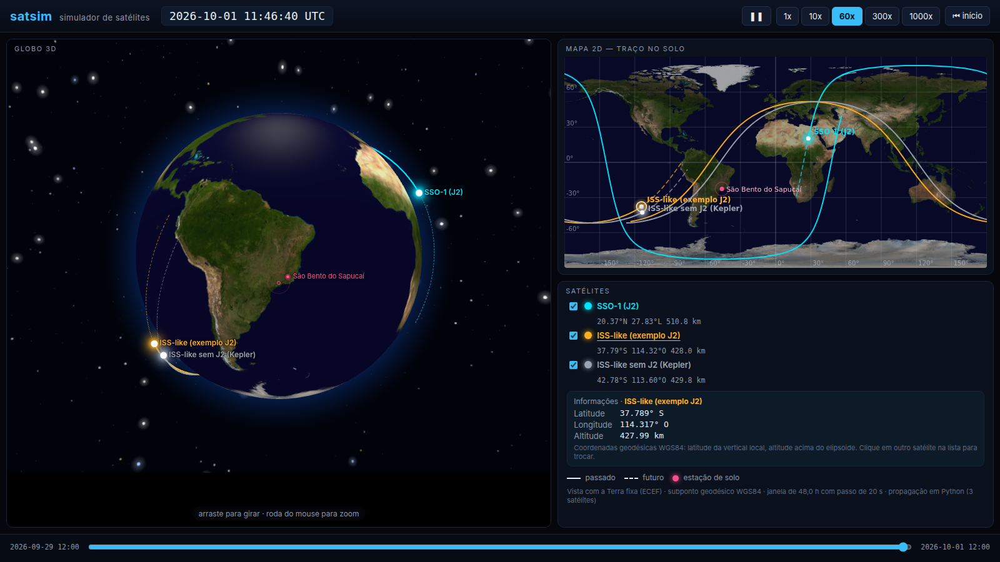

# satellite_constelation_simulation

**satsim** — simulador de posicionamento de satélites em Python, modular e fácil de estender
para mais satélites.

**Objetivo final:** uma simulação **próxima da real para um satélite em órbita heliossíncrona
(SSO)**, com um propagador **completo e generalizável para qualquer órbita**. A **ISS** é o
**comparador real**: o TLE dela é público e atualizado várias vezes por dia, e comparar o nosso
propagador com o SGP4 da ISS (e, depois, de satélites reais em SSO) mede quão perto o simulador
está de um simulador real. Ver a revisão do planejamento em
[`docs/semana3_fechamento.md`](docs/semana3_fechamento.md) (seção 6).

- **Fase 1 (semanas 1–3, concluída):** núcleo de propagação (Kepler, J2 médio, Cowell com J2 e
  arrasto), ISS real via TLE/SGP4, estação de São Bento do Sapucaí (SP) e passagens, com GUI.
- **Fase 2 (proposta):** propagador fiel e geral: J3/J4 no Cowell, conversão médio ↔ osculador,
  validação contra o SGP4 numa SSO real, modelo médio estendido para projeto e órbita congelada.
- **Fase 3:** constelação heliossíncrona (6 → 18 satélites), cobertura e aplicação web.

Todo propagador implementa `propagate(t) -> (r, v)` vetorizado; adicionar satélites é apenas
instanciar mais objetos. Unidades SI, ângulos em radianos internamente, tempo em UTC
(`datetime` com fuso).

## Instalação

Requer Python ≥ 3.11.

```bash
python -m venv .venv
source .venv/bin/activate        # Windows: .venv\Scripts\activate
pip install -e ".[dev]"
```

## Comandos

```bash
pytest               # testes
ruff check .         # lint
ruff format .        # formatação (use --check para só verificar)
```

## Estrutura

```
pyproject.toml               empacotamento, pytest e ruff
.github/workflows/ci.yml     CI: lint + testes em Python 3.11 e 3.12
docs/adr/                    decisões de arquitetura (ADR)
docs/creditos.md             créditos e licenças dos assets do viewer e dos TLEs
docs/semana3_fechamento.md   fechamento da Semana 3 e revisão do planejamento
docs/codigo_explicado/       explicação detalhada do código (HTML; o PDF é gerado dele)
src/satsim/                  código da biblioteca
src/satsim/app/              GUI: exportação da cena (Python) e viewer (static/)
scripts/build_demo.py        gera a demo visual demo/index.html
scripts/                     também: relatório da Semana 2, traço no solo, Tabela 1 (SSO),
                             TLE da ISS (fetch_tle.py)
reports/s2_comparacao/       figuras e relatório da Semana 2 (versionados)
reports/s3_arrasto/          gráfico e relatório Cowell × SGP4 da Semana 3 (versionados)
tests/                       testes (pytest)
```

## Demo visual



Globo 3D e mapa 2D na mesma tela e sincronizados. Tudo é calculado em Python; o viewer só
desenha. A demo cobre **24 h a partir de agora** (passo de 20 s), ou o ciclo inteiro de 6 dias
com `--days 6`, com oito satélites:

| Satélite | Propagador | O que mostra |
|---|---|---|
| S1 … S6 (constelação 91/6) | `CowellPropagator` completo (J2–J4 + Sol/Lua + SRP + arrasto) | os 6 satélites de `sso_constellation` num único plano, 60° entre vizinhos: a calibrado (S5-02), i = 97,46325°, e congelada, ω = 90°, LTAN 22h30 no início da cena (S5-06) |
| ISS | `SGP4Propagator` | a ISS real, a partir do TLE mais recente (CelesTrak → cache → TLE embarcado); desligada no início |
| Sentinel-2A | `SGP4Propagator` | uma SSO real a ≈ 786 km (TLE da CelesTrak → cache → TLE embarcado), para comparar com a de projeto (S4-06); desligada no início |

### Constelação 91/6 (Semana 5)


- **Seis satélites em fila no mesmo plano:** no globo, a órbita prevista é desenhada uma vez (a
  do satélite selecionado) e cada satélite deixa a sua trilha colorida. Como as órbitas são
  iguais, os seis passam pelos mesmos pontos do espaço, um a cada ≈ 15,8 min.
- **Grade do dia** (camada do mapa): cada nó ascendente já percorrido vira um traço vertical no
  equador, com a cor do satélite. O título do mapa conta quantas das 91 trilhas já foram
  percorridas: com os seis satélites, a grade se completa em 1 dia; com `--days 6` e só um
  satélite ligado, as 91 trilhas aparecem uma a uma ao longo do ciclo (a melhor demonstração do
  projeto, Sem4 §9.4).
- **Faixa** (camada do mapa): a área que a câmera alcança com a rolagem de meia grade (±23,2°,
  λ ≈ 2° para cada lado), ao longo das últimas 100 min de traço. As faixas vizinhas se encostam.
- **Painel Informações** de um membro: **fase Δu** em relação a S1 (S2 = −60°, S4 = ±180°…),
  **próxima correção do traço** (contagem regressiva a partir dos ≈ 6,9 dias do S5-05; a cena
  não simula manobras) e **Δv/ano** de manutenção (traço + inclinação).
- **Legenda agrupada:** "Constelação 91/6" com uma caixa que liga/desliga os seis; ISS e
  Sentinel-2A ficam em "Outros satélites", desligados no início. Com a constelação, o círculo de
  visibilidade da estação aparece só para o satélite selecionado.

### 6 ou 18 satélites (Semana 6)


A barra superior ganha o seletor **"6 satélites | 18 satélites"**. A troca abre o arquivo irmão
(`demo/index.html` ↔ `demo/constelacao18.html`, ou `ciclo_6dias.html` ↔ `ciclo_6dias_18.html`)
**no mesmo instante**, com a mesma velocidade, as mesmas camadas e o satélite correspondente
selecionado (S4 de 18 ↔ S2 de 6). Funciona com duplo clique, sem servidor.

- **18 satélites no mesmo plano**, 20° entre vizinhos: cada um passa 5,3 min depois do anterior
  e deixa o seu traço um terço de passo de grade a oeste. São **273 trilhas por dia** (1,32° no
  equador), e não 3 passagens sobre as mesmas 91. O título do mapa conta "grade: X de 273".
- **Faixa** com a rolagem que fecha a grade diária: **±8,18°** com 18, contra ±23,2° com 6. A
  demonstração da semana: com a camada "grade do dia" ligada, alterne entre 6 e 18 no mesmo
  instante e veja as trilhas triplicarem enquanto a faixa encolhe.
- **Legenda por família:** "Constelação 91/6 · 18 satélites" com uma caixa para todos e três
  famílias recolhíveis. A família A (S1, S4, …, S16) ocupa as posições da constelação de 6, com
  as mesmas cores; B e C são cópias deslocadas de 1/3 e 2/3 de passo, com as cores escurecidas e
  clareadas.
- **Painel Informações:** fase Δu em passos de 20° (S2 = −20°), família, rolagem para cobertura
  diária, próxima correção e Δv/ano (os mesmos dos 6: mesma órbita, mesmo arrasto).
- **Desempenho:** com 20 objetos (18 + ISS + Sentinel-2A), o quadro 2D leva ≈ 6 ms no Chrome
  headless com rasterização por software (≈ 4 ms de JavaScript). A posição entre amostras é uma
  interpolação Hermite cúbica no vetor unitário (erro ≤ 1,1 km com passo de 120 s), o que permite
  a cena de 6 dias com 18 satélites caber em 11,6 MB.

E, para a estação de São Bento do Sapucaí (elevação mínima de 10°):

- **painel "ISS × São Bento do Sapucaí"**: elevação, azimute e distância atuais e o estado,
  com cor própria: *visível* (acima de 10°, verde), *baixo* (entre 0° e 10°, amarelo) ou
  *abaixo do horizonte*;
- **contagem regressiva** para a próxima passagem (ou o tempo que falta para a atual terminar);
- **lista de passagens** em UTC e no horário de Brasília (BRT), com elevação máxima e duração;
  clicar numa passagem leva o relógio a 60 s antes do AOS. As passagens também aparecem como
  marcas verdes na linha do tempo;
- **linha estação → satélite** no globo, colorida pelo estado, enquanto o satélite está acima
  do horizonte;
- **círculo de visibilidade (footprint)** no mapa: a região do solo de onde o satélite é visto
  acima de 10° (≈ 12,5° de raio, ≈ 1 400 km, para a ISS). A estação está dentro dele
  exatamente durante as passagens;
- **faixa do TLE** abaixo da barra superior: época, idade e fonte do TLE, em destaque quando a
  idade passa de 3 dias (a posição real pode diferir de dezenas de km).

No painel **Informações** do satélite selecionado (S4-06): **LTAN** (hora local do nó
ascendente; nos seis satélites da constelação fica em 22h30 o dia inteiro, na ISS muda continuamente), **β** (ângulo entre
o plano da órbita e o Sol) e **Sol**: *iluminado* ou *em eclipse*. Na sombra da Terra o marcador
do satélite fica esmaecido, no globo e no mapa; na constelação, cerca de 36% de cada volta (≈ 35 min).

As passagens do viewer são as mesmas de `scripts/list_passes.py` (a mesma função,
`satsim.passes.find_passes`).

**Gerar** (na raiz do repositório, com o venv ativo):

```bash
python scripts/build_demo.py              # constelação + ISS e Sentinel-2A reais, 24 h (~7 MB, ~10 s)
python scripts/build_demo.py --days 6     # o ciclo inteiro de 6 dias, passo de 60 s (~11 MB, ~40 s)
python scripts/build_demo.py --sats 18    # 18 satélites → demo/constelacao18.html (~11 MB, ~30 s)
python scripts/build_demo.py --all        # as quatro cenas ligadas pelo seletor 6 | 18 (~3 min)
python scripts/build_demo.py --offline    # sem rede: cache local ou TLE embarcado
python scripts/build_demo.py --tle-file tests/data/iss_sample.tle --start tle-epoch   # reprodutível
```

O seletor "6 satélites | 18 satélites" só aparece nas cenas geradas com `--all` (as quatro têm a
mesma época e se referenciam por caminhos relativos). Passos e tamanhos: 6 satélites, 20 s em 1
dia (6,7 MB) e 60 s em 6 dias (11,2 MB); 18 satélites, 20 s em 1 dia (11,4 MB) e 120 s em 6 dias
(11,6 MB).

**Abrir:** dê dois cliques em `demo/index.html`, ou rode `xdg-open demo/index.html` no Linux
(`open` no macOS). Não precisa de servidor nem de internet: biblioteca, textura e cena vão
embutidas no arquivo. A rede só é usada ao **gerar** a demo, para baixar um TLE recente, e é
opcional. A pasta `demo/` não é versionada; gere de novo para atualizar a ISS.

**Adicionar um satélite:** acrescente-o à lista `satellites` montada em `build_demo` de
[`scripts/build_demo.py`](scripts/build_demo.py): um `SceneSatellite(id, nome, cor,
propagador)` ou um `Satellite` com qualquer propagador (a constelação, em
`build_constellation`, usa a receita "elementos médios → `mean_to_osculating` → Cowell
completo" de `sso_constellation`). Por exemplo, com elementos médios de J2:

```text
SceneSatellite("kep2", "Quarto (i = 30°)", "#b26bff", MeanJ2Propagator(KeplerianElements(7200e3, 0.01, math.radians(30), math.radians(200), 0.0, math.radians(90)), start)),
```

e gere a demo de novo. O viewer lê quantos satélites houver na cena (testado com 18); cada um
ganha o seu footprint e as suas passagens. O painel da estação mostra o satélite selecionado na
lista.

**Controles:**

| Controle | Ação |
|---|---|
| ▶ / ❚❚ (ou barra de espaço) | reproduzir / pausar |
| 1x · 10x · 60x · 300x · 1000x · 5000x | velocidade da simulação (5000x: 1 dia em ≈ 17 s) |
| linha do tempo (embaixo) | arrastar para qualquer instante da janela; marcas verdes = passagens |
| ⏮ início | voltar ao início da janela |
| passagem na lista | ir a 60 s antes do AOS |
| caixas na lista de satélites | mostrar / ocultar cada satélite; a do grupo, a constelação inteira |
| camadas do mapa | ligar / desligar a grade do dia e a faixa |
| nome na lista de satélites | selecionar: os painéis **Informações** e da estação passam a mostrar esse satélite |
| arrastar / roda do mouse no globo | girar / zoom |

No mapa, a linha cheia é o traço já percorrido, a tracejada é o futuro e o círculo é o footprint.
São Bento do Sapucaí aparece em rosa nos dois painéis. A vista mantém a Terra fixa (ECEF); o
subponto é geodésico WGS84 (latitude da vertical local, altitude acima do elipsoide). "Passagem"
aqui é visibilidade por rádio (satélite acima de 10°); ver a ISS a olho nu, com o Sol abaixo do
horizonte e a ISS iluminada, entra na Semana 4. Os créditos e licenças dos assets estão em
[`docs/creditos.md`](docs/creditos.md).

## Relatório da Semana 2

Comparação Kepler × MeanJ2 × Cowell (J2): o que J2 muda na órbita e o que cada propagador
entrega. Um único comando gera as figuras e o relatório em
[`reports/s2_comparacao/`](reports/s2_comparacao/):

```bash
python scripts/compare_propagators.py      # ~5 s; 5 figuras PNG + relatorio.md
```

O [`relatorio.md`](reports/s2_comparacao/relatorio.md) traz, para a SSO de projeto, uma órbita
tipo ISS e uma órbita de teste com e = 0,02 (10 dias a 60 s): a regressão do nó medida no Cowell
contra a teoria secular, a rotação do perigeu, a oscilação de curto período do semieixo, o erro
de posição do MeanJ2 e do Kepler contra o Cowell, e um parágrafo de conclusões. A lição central é
a diferença entre **elementos médios e osculadores**: os mesmos números nominais usados como
condição inicial do Cowell descrevem uma órbita média alguns km diferente, o que separa os dois
propagadores em ~1 000 km em 24 h; com os elementos médios medidos, a diferença cai para < 15 km.

Também na pasta: o traço no solo da SSO e da órbita tipo ISS
(`python scripts/plot_ground_track.py --preset sso` ou `--preset iss-like`), e a Tabela 1 do
Sem4 (órbitas heliossíncronas) sai de `python scripts/print_sso_table.py`.

## TLE da ISS (Semana 3)

A ISS real entra pelo seu TLE (Two-Line Element set), baixado da
[CelesTrak](https://celestrak.org/). Para o simulador funcionar sem internet,
`satsim.tle.get_tle()` busca o TLE em camadas:

1. **cache** em disco com menos de 2 h (a CelesTrak pede no máximo 1 consulta a cada 2 h);
2. **rede** (CelesTrak), gravando o cache;
3. falha de rede ou resposta inválida → **cache de qualquer idade**, com aviso;
4. sem cache → **TLE embarcado** no pacote (`src/satsim/data/iss_fallback.tle`), com aviso.

O cache fica em `data/cache/tle/<norad>.json` (relativo ao diretório de trabalho, não
versionado); mude com `--cache-dir` ou com a variável de ambiente `SATSIM_CACHE_DIR`. A precisão
cai com a idade do TLE: acima de 3 dias sai um aviso de precisão degradada, acima de 14 dias um
aviso forte.

```bash
python scripts/fetch_tle.py              # usa o cache (< 2 h) ou baixa da CelesTrak
python scripts/fetch_tle.py --offline    # nunca acessa a rede (cache ou TLE embarcado)
python scripts/fetch_tle.py --norad 25544 --cache-dir /tmp/tle
```

Saída (o TLE, depois fonte, data do download, época e idade; avisos no stderr):

```text
ISS (ZARYA)
1 25544U 98067A   26286.82178372  .00006592  00000+0  12831-3 0  9991
2 25544  51.6325  73.0089 0006710 259.3258 100.6975 15.48855783590140
fonte:      network
baixado em: 2026-10-14T11:47:21+00:00
época:      2026-10-13T19:43:22+00:00
idade:      0.67 dias
```

Os testes não acessam a rede: usam o TLE congelado de `tests/data/iss_sample.tle` (época
2019-12-09) e simulam a CelesTrak.

## Passagens sobre São Bento do Sapucaí (Semana 3)

`scripts/list_passes.py` lista quando a ISS passa acima de uma elevação mínima sobre São Bento do
Sapucaí, com AOS (nasce), TCA (máxima elevação) e LOS (se põe), em UTC e no horário de Brasília
(BRT = UTC−03:00). O TLE vem de `get_tle` (cache → CelesTrak → TLE embarcado), e o script mostra a
fonte e a idade do TLE no início da janela, com aviso acima de 3 dias.

```bash
python scripts/list_passes.py                        # próximos 3 dias, el ≥ 10°
python scripts/list_passes.py --days 7 --el-min 5 --offline --csv passagens.csv
python scripts/list_passes.py --tle-file tests/data/iss_sample.tle --start tle-epoch
```

Saída do último comando (TLE de teste, reproduz o Apêndice A.2 do prompt da Semana 3):

```text
TLE:      ISS (ZARYA) (catálogo 25544), fonte: arquivo tests/data/iss_sample.tle
época:    2019-12-09 16:38:29 UTC
idade:    0.00 dias no início da janela
estação:  São Bento do Sapucaí (-22.69°, -45.73°, 900 m)
janela:   2019-12-09 16:38 UTC + 3 dia(s), el ≥ 10°

 #  satélite     AOS UTC              AOS BRT   TCA BRT   LOS BRT   el máx  az AOS/TCA/LOS [°]     dur
------------------------------------------------------------------------------------------------------
 1  ISS (ZARYA)  2019-12-10 00:46:08  21:46:08  21:49:26  21:52:46   54.7°  333.4/ 51.9/130.3     6.6m
 2  ISS (ZARYA)  2019-12-10 10:35:48  07:35:48  07:39:02  07:42:14   46.9°  232.8/307.7/ 22.7     6.4m
 3  ISS (ZARYA)  2019-12-10 23:58:15  20:58:15  21:01:03  21:03:53   24.3°  357.9/ 54.3/110.6     5.6m
 4  ISS (ZARYA)  2019-12-11 01:35:27  22:35:27  22:37:44  22:40:02   16.7°  265.9/223.5/181.2     4.6m
 5  ISS (ZARYA)  2019-12-11 09:47:15  06:47:15  06:50:37  06:53:56   71.5°  215.4/130.3/ 45.3     6.7m
 6  ISS (ZARYA)  2019-12-11 23:11:26  20:11:26  20:12:43  20:14:00   11.7°   34.0/ 56.4/ 78.8     2.6m
 7  ISS (ZARYA)  2019-12-12 00:46:06  21:46:06  21:49:10  21:52:16   31.5°  291.9/226.7/161.6     6.2m
 8  ISS (ZARYA)  2019-12-12 08:59:04  05:59:04  06:02:08  06:05:09   31.4°  198.4/133.3/ 68.2     6.1m
 9  ISS (ZARYA)  2019-12-12 10:37:28  07:37:28  07:38:34  07:39:40   11.3°  284.1/303.5/323.0     2.2m
```

"Passagem" aqui é o satélite acima da elevação mínima (visibilidade por rádio); ver a ISS a olho
nu exige também Sol abaixo do horizonte e satélite iluminado (Semana 4). A previsão perde precisão
com a idade do TLE: prefira um TLE com menos de 3 dias. Em Python:
`satsim.passes.find_passes(propagador, estação, início, duração, el_min_deg=10)` funciona com
qualquer propagador; `find_passes_many` junta vários satélites, ordenados por AOS.

## Relatório do arrasto (Semana 3)

Cowell com J2 e arrasto atmosférico contra o SGP4 da ISS (TLE de teste, época 2019-12-09). Um
comando gera o gráfico e o relatório em [`reports/s3_arrasto/`](reports/s3_arrasto/):

```bash
python scripts/compare_sgp4_cowell.py      # ~1 min; 2 gráficos PNG + relatorio.md
```

Erro de posição 3D contra o SGP4 em 24 h / 72 h / 7 dias: só J2, 1,0 / 8,7 / 47 km; J2 + arrasto
com os parâmetros padrão (C_D = 2,2, A/m = 0,004), 5,8 / 52 / 286 km; J2 + arrasto com C_D·A/m
ajustado ao SGP4 (0,00163 m²/kg), 0,3 / 2,7 / 14,5 km. O arrasto padrão piora o resultado porque
dezembro de 2019 foi mínimo solar e a atmosfera de Vallado (atividade moderada) é mais densa que a
real; o [`relatorio.md`](reports/s3_arrasto/relatorio.md) explica. A atmosfera
(`satsim.forces.atmosphere`), o arrasto (`satsim.forces.drag`) e o decaimento analítico
(`satsim.decay`: taxa, perda por revolução e tempo de vida) reproduzem os números do Sem3.

## Golden tests

[`tests/golden/reference_values.py`](tests/golden/reference_values.py) reúne, num único arquivo
versionado, os números de referência dos PDFs teóricos (`docs/referencias/`: Sem3, decaimento
em LEO; Sem4, órbita heliossíncrona): constantes, órbita de projeto 91/6, Tabelas 1, 3 e 4 do
Sem4, taxas seculares de J2 e valores de arrasto do Sem3. Os testes de cada semana importam
esses valores em vez de repetir números soltos, por exemplo
`from golden.reference_values import DESIGN_ORBIT`.

[`tests/test_golden_consistency.py`](tests/test_golden_consistency.py) confere a coerência
interna dos números (por exemplo, `86400 / Tnod ≈ rev/dia`, `360° / N ≈ grade`, e o mesmo valor
igual em tabelas diferentes), para pegar erros de transcrição. Uma discrepância encontrada no
próprio PDF fica registrada como `xfail(strict=True)`, com a explicação no `reason`.

Para adicionar um valor:

1. coloque-o no grupo certo (ou crie um grupo novo, como `@dataclass(frozen=True)`), exatamente
   como aparece no documento, com o sufixo da unidade no nome (`h_km`, `i_deg`, `tnod_s`);
2. cite a fonte num comentário (documento, seção, tabela ou equação);
3. se o número puder ser deduzido de outros, acrescente um teste de consistência.

## Limitações

### Manutenção da SSO em intervalos longos (correção de trajetória)

A física do propagador é completa o bastante para mostrar que **nenhuma órbita heliossíncrona
mantém o LTAN constante para sempre sem manobras**. Só com a gravidade da Terra (J2–J4), a
precessão do nó é linear e uma inclinação calibrada mantém o LTAN fixo. Com o Sol, o efeito muda:

- numa SSO a geometria entre o plano da órbita e o Sol fica congelada (é a definição de LTAN
  constante), então a maré solar empurra a inclinação sempre no mesmo sentido. Para a SSO de
  projeto com LTAN 22h30, di/dt ≈ −1e-4 °/dia ≈ **−0,036°/ano** (medido no Cowell no S4-02);
- como Ω̇ depende de i (via J2), o nó e o LTAN passam a derivar de forma ~quadrática no tempo:
  em poucos anos são dezenas de minutos de LTAN;
- a Lua soma termos periódicos de ~14 dias, e o Sol um termo semestral.

Missões reais corrigem isso com **manobras periódicas de inclinação**, espaçadas de meses a anos.
A ordem de grandeza do custo é Δv ≈ v·Δi ≈ 7 607 m/s × 6,3e-4 rad ≈ **4,8 m/s por ano** de deriva
corrigida.

**O simulador não cobre isso:**

- não há modelo de manobras nem de manutenção de órbita (faixa de tolerância de LTAN ou de
  inclinação, data prevista da próxima correção, Δv);
- a demo visual cobre só **24 h**. Nesse intervalo a deriva causada pelo Sol é de milésimos de
  minuto de LTAN, invisível na tela. O efeito só aparece em escalas de meses a anos, que exigem
  um propagador médio rápido (e não o Cowell da cena) com o termo solar em di/dt.

Um indicador de manutenção da SSO no painel (deriva prevista, próxima correção e Δv/ano) está
registrado como proposta para as próximas semanas.

### A referência da validação é o SGP4

A determinação de órbita (`satsim.orbit_determination.fit_initial_state`, S4-06) escolhe o
estado inicial e o C_D·A/m do Cowell que deixam a trajetória **o mais perto possível das
posições do SGP4** numa janela de 72 h. O SGP4 faz o papel das medidas de radar. Então, aqui,
"órbita mais correta" quer dizer **a que mais concorda com o SGP4**, e não com a órbita real do
satélite. Consequências:

- **O erro medido é Cowell × SGP4, não Cowell × realidade.** O SGP4 erra ≈ 1 km na época e
  alguns km por dia. Erros do Cowell abaixo disso não dão para distinguir.
- **O C_D·A/m ajustado é efetivo em relação ao SGP4.** Ele reproduz o decaimento que o SGP4
  aplica (densidade do próprio SGP4, escalada pelo B\* do TLE), não o coeficiente físico. No
  Sentinel-2A sai ≈ 0,014 m²/kg ([relatório do S4-06](reports/s4_alta_fidelidade/relatorio.md)).
- **Forças que o SGP4 não tem pioram o acordo.** Em LEO o SGP4 não tem Sol, Lua nem SRP.
  Acrescentá-las ao Cowell aproxima a órbita real, mas afasta do SGP4: em 7 dias o erro sobe de
  0,03 para 0,36 km no Sentinel-2A. O SGP4 não valida essas forças; elas foram validadas por
  componentes no S4-02, contra as efemérides DE421.

**Trocar por uma referência mais precisa não exige mudar `orbit_determination.py`.** O
`fit_initial_state` aceita qualquer `Propagator` como `reference`. Basta uma nova classe que
implemente `propagate(t) → (r, v)` a partir das efemérides melhores e passá-la no lugar do
`SGP4Propagator`. Exemplos de efemérides: as órbitas precisas (POD/SP3, erro de centímetros)
que o Copernicus publica para os Sentinel, ou dados de GNSS de bordo. A classe interpola essas
efemérides e as converte para o ECI do projeto (TEME). Com essa referência:

- o C_D·A/m ajustado passa a ter significado físico;
- Sol, Lua e SRP passam a melhorar o acordo em vez de piorá-lo;
- vale reavaliar o resto do ajuste: o espaçamento das amostras (`step_s`), o tamanho da janela
  e ajustar também o C_R da SRP.

## Roadmap

**Concluído:**

| Semana | Entrega |
|---|---|
| 1 | Fundação e núcleo kepleriano: CI, ADR, constantes, elementos ↔ estado, propagador kepleriano, tempo (JD/GMST), golden tests |
| 2 | Perturbação J2 (elementos médios), quadros ECI/ECEF, geodésia e projeto de órbita (SSO 91/6) |
| 3 | ISS real (TLE/SGP4), arrasto no Cowell e validação contra o SGP4, estação de solo, passagens e GUI |

**Planejamento revisado (proposta da revisão da Semana 3, out/2026; a confirmar nos prompts das
próximas semanas):** o objetivo passou a ser um propagador fiel e geral para uma SSO, com a ISS
como comparador real. Detalhes e justificativa em
[`docs/semana3_fechamento.md`](docs/semana3_fechamento.md), seção 6.

| Ordem | Entrega | Por quê |
|---|---|---|
| 1 | J3 e J4 no Cowell | completa a gravidade zonal; reduz o erro × SGP4 que hoje o coeficiente de arrasto ajustado absorve |
| 2 | Conversão médio ↔ osculador (Brouwer/Kozai) | liga o projeto (elementos médios) à simulação (Cowell) sem perder a heliossincronia |
| 3 | Cowell × SGP4 numa SSO real (ex.: Sentinel-2A, NORAD 40697; Landsat 8, NORAD 39084) | valida o simulador no regime do satélite final |
| 4 | Modelo médio estendido (J2–J4 + arrasto médio) e órbita congelada | projeto e manutenção da SSO |
| 5 | Sol/Lua, pressão de radiação e atmosfera com atividade solar (F10.7) no Cowell | fidelidade de longo prazo |
| 6 | Constelação SSO (6 → 18 satélites), cobertura e aplicação web | com o propagador fiel já validado |

O roadmap original previa, depois da Semana 3: visibilidade óptica da ISS (Sol e iluminação,
Semana 4), constelação de 6 satélites e cobertura (Semana 5), aplicação web (Semana 6) e 18
satélites (Semana 7). A visibilidade óptica continua útil e independente das entregas acima.
