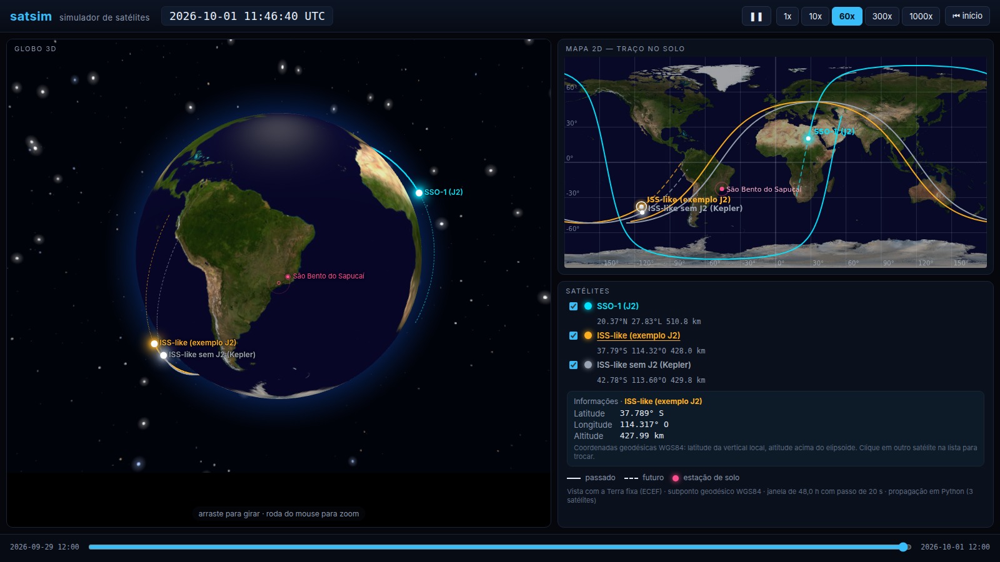

# satellite_constelation_simulation

**satsim** — simulador de posicionamento de satélites em Python, modular e fácil de estender
para mais satélites.

- **Fase 1 (semanas 1–4):** um satélite (a ISS), com posição e horários de visibilidade sobre
  São Bento do Sapucaí (SP).
- **Fase 2 (semana 5):** generalização para 6 satélites (constelação heliossíncrona 91/6, um
  plano).
- **Fase 3 (semanas 6–7, se houver tempo):** aplicação web com deploy e 18 satélites.

Todo propagador implementa `propagate(t) -> (r, v)` vetorizado; adicionar satélites é apenas
instanciar mais objetos. Unidades SI, ângulos em radianos internamente, tempo em UTC
(`datetime` com fuso).

## Instalação

Requer Python ≥ 3.11.

```bash
python -m venv .venv
source .venv/bin/activate        # Windows: .venv\Scripts\activate
pip install -e ".[dev]"
```

## Comandos

```bash
pytest               # testes
ruff check .         # lint
ruff format .        # formatação (use --check para só verificar)
```

## Estrutura

```
pyproject.toml               empacotamento, pytest e ruff
.github/workflows/ci.yml     CI: lint + testes em Python 3.11 e 3.12
docs/adr/                    decisões de arquitetura (ADR)
docs/creditos.md             créditos e licenças dos assets do viewer
src/satsim/                  código da biblioteca
src/satsim/app/              GUI: exportação da cena (Python) e viewer (static/)
scripts/build_demo.py        gera a demo visual demo/index.html
scripts/                     também: relatório da Semana 2, traço no solo, Tabela 1 (SSO),
                             TLE da ISS (fetch_tle.py)
reports/s2_comparacao/       figuras e relatório da Semana 2 (versionados)
reports/s3_arrasto/          gráfico e relatório Cowell × SGP4 da Semana 3 (versionados)
tests/                       testes (pytest)
```

## Demo visual



Globo 3D e mapa 2D com o traço no solo, na mesma tela e sincronizados. As órbitas são calculadas
em Python e o viewer só desenha. A demo cobre **48 h** (passo de 20 s) com três satélites:

| Satélite | Propagador | O que mostra |
|---|---|---|
| SSO-1 (J2) | `MeanJ2Propagator` | a órbita heliossíncrona de projeto 91/6 |
| ISS-like (exemplo J2) | `MeanJ2Propagator` | órbita tipo ISS (a = R⊕ + 420 km, i = 51,64°) com J2 |
| ISS-like sem J2 (Kepler) | `KeplerPropagator` | a mesma órbita sem J2, em cinza |

**O efeito de J2 fica visível:** as duas ISS-like começam juntas e se separam no mapa, porque J2
faz o plano da órbita girar (regressão do nó, ≈ −9,9° em 2 dias). Arraste a linha do tempo até o
fim da janela para ver os dois traços deslocados. A ISS-like é só um exemplo: a ISS real (TLE/SGP4)
entra na Semana 3.

**Gerar** (na raiz do repositório, com o venv ativo):

```bash
python scripts/build_demo.py      # cria demo/index.html (~4 MB, autocontido)
```

**Abrir:** dê dois cliques em `demo/index.html`, ou rode `xdg-open demo/index.html` no Linux
(`open` no macOS). Não precisa de servidor nem de internet: biblioteca, textura e cena vão
embutidas no arquivo. A pasta `demo/` não é versionada; gere de novo quando o código mudar.

**Adicionar um satélite:** acrescente uma linha à lista `SATELLITES` em
[`scripts/build_demo.py`](scripts/build_demo.py), por exemplo

```text
sat("kep2", "Quarto (i = 30°)", "#b26bff", MeanJ2Propagator, a_km=7200.0, e=0.01, i_deg=30.0, raan_deg=200.0, argp_deg=0.0, psi_deg=90.0),
```

(o quarto argumento é o propagador: `MeanJ2Propagator` com J2, `KeplerPropagator` sem J2)

e gere a demo de novo. O viewer lê quantos satélites houver na cena (testado com 18).

**Controles:**

| Controle | Ação |
|---|---|
| ▶ / ❚❚ (ou barra de espaço) | reproduzir / pausar |
| 1x · 10x · 60x · 300x · 1000x | velocidade da simulação |
| linha do tempo (embaixo) | arrastar para qualquer instante da janela de 48 h |
| ⏮ início | voltar ao início da janela |
| caixas na lista de satélites | mostrar / ocultar cada satélite |
| nome na lista de satélites | selecionar: o painel **Informações** mostra latitude, longitude e altitude geodésicas atuais |
| arrastar / roda do mouse no globo | girar / zoom |

No mapa, a linha cheia é o traço já percorrido e a tracejada é o futuro. São Bento do Sapucaí
aparece em rosa nos dois painéis. A vista mantém a Terra fixa (ECEF); o subponto é geodésico
WGS84 desde a Semana 2 (latitude da vertical local, altitude acima do elipsoide). Os créditos e
licenças dos assets estão em [`docs/creditos.md`](docs/creditos.md).

## Relatório da Semana 2

Comparação Kepler × MeanJ2 × Cowell (J2): o que J2 muda na órbita e o que cada propagador
entrega. Um único comando gera as figuras e o relatório em
[`reports/s2_comparacao/`](reports/s2_comparacao/):

```bash
python scripts/compare_propagators.py      # ~5 s; 5 figuras PNG + relatorio.md
```

O [`relatorio.md`](reports/s2_comparacao/relatorio.md) traz, para a SSO de projeto, uma órbita
tipo ISS e uma órbita de teste com e = 0,02 (10 dias a 60 s): a regressão do nó medida no Cowell
contra a teoria secular, a rotação do perigeu, a oscilação de curto período do semieixo, o erro
de posição do MeanJ2 e do Kepler contra o Cowell, e um parágrafo de conclusões. A lição central é
a diferença entre **elementos médios e osculadores**: os mesmos números nominais usados como
condição inicial do Cowell descrevem uma órbita média alguns km diferente, o que separa os dois
propagadores em ~1 000 km em 24 h; com os elementos médios medidos, a diferença cai para < 15 km.

Também na pasta: o traço no solo da SSO e da órbita tipo ISS
(`python scripts/plot_ground_track.py --preset sso` ou `--preset iss-like`), e a Tabela 1 do
Sem4 (órbitas heliossíncronas) sai de `python scripts/print_sso_table.py`.

## TLE da ISS (Semana 3)

A ISS real entra pelo seu TLE (Two-Line Element set), baixado da
[CelesTrak](https://celestrak.org/). Para o simulador funcionar sem internet,
`satsim.tle.get_tle()` busca o TLE em camadas:

1. **cache** em disco com menos de 2 h (a CelesTrak pede no máximo 1 consulta a cada 2 h);
2. **rede** (CelesTrak), gravando o cache;
3. falha de rede ou resposta inválida → **cache de qualquer idade**, com aviso;
4. sem cache → **TLE embarcado** no pacote (`src/satsim/data/iss_fallback.tle`), com aviso.

O cache fica em `data/cache/tle/<norad>.json` (relativo ao diretório de trabalho, não
versionado); mude com `--cache-dir` ou com a variável de ambiente `SATSIM_CACHE_DIR`. A precisão
cai com a idade do TLE: acima de 3 dias sai um aviso de precisão degradada, acima de 14 dias um
aviso forte.

```bash
python scripts/fetch_tle.py              # usa o cache (< 2 h) ou baixa da CelesTrak
python scripts/fetch_tle.py --offline    # nunca acessa a rede (cache ou TLE embarcado)
python scripts/fetch_tle.py --norad 25544 --cache-dir /tmp/tle
```

Saída (o TLE, depois fonte, data do download, época e idade; avisos no stderr):

```text
ISS (ZARYA)
1 25544U 98067A   26286.82178372  .00006592  00000+0  12831-3 0  9991
2 25544  51.6325  73.0089 0006710 259.3258 100.6975 15.48855783590140
fonte:      network
baixado em: 2026-10-14T11:47:21+00:00
época:      2026-10-13T19:43:22+00:00
idade:      0.67 dias
```

Os testes não acessam a rede: usam o TLE congelado de `tests/data/iss_sample.tle` (época
2019-12-09) e simulam a CelesTrak.

## Passagens sobre São Bento do Sapucaí (Semana 3)

`scripts/list_passes.py` lista quando a ISS passa acima de uma elevação mínima sobre São Bento do
Sapucaí, com AOS (nasce), TCA (máxima elevação) e LOS (se põe), em UTC e no horário de Brasília
(BRT = UTC−03:00). O TLE vem de `get_tle` (cache → CelesTrak → TLE embarcado), e o script mostra a
fonte e a idade do TLE no início da janela, com aviso acima de 3 dias.

```bash
python scripts/list_passes.py                        # próximos 3 dias, el ≥ 10°
python scripts/list_passes.py --days 7 --el-min 5 --offline --csv passagens.csv
python scripts/list_passes.py --tle-file tests/data/iss_sample.tle --start tle-epoch
```

Saída do último comando (TLE de teste, reproduz o Apêndice A.2 do prompt da Semana 3):

```text
TLE:      ISS (ZARYA) (catálogo 25544), fonte: arquivo tests/data/iss_sample.tle
época:    2019-12-09 16:38:29 UTC
idade:    0.00 dias no início da janela
estação:  São Bento do Sapucaí (-22.69°, -45.73°, 900 m)
janela:   2019-12-09 16:38 UTC + 3 dia(s), el ≥ 10°

 #  satélite     AOS UTC              AOS BRT   TCA BRT   LOS BRT   el máx  az AOS/TCA/LOS [°]     dur
------------------------------------------------------------------------------------------------------
 1  ISS (ZARYA)  2019-12-10 00:46:08  21:46:08  21:49:26  21:52:46   54.7°  333.4/ 51.9/130.3     6.6m
 2  ISS (ZARYA)  2019-12-10 10:35:48  07:35:48  07:39:02  07:42:14   46.9°  232.8/307.7/ 22.7     6.4m
 3  ISS (ZARYA)  2019-12-10 23:58:15  20:58:15  21:01:03  21:03:53   24.3°  357.9/ 54.3/110.6     5.6m
 4  ISS (ZARYA)  2019-12-11 01:35:27  22:35:27  22:37:44  22:40:02   16.7°  265.9/223.5/181.2     4.6m
 5  ISS (ZARYA)  2019-12-11 09:47:15  06:47:15  06:50:37  06:53:56   71.5°  215.4/130.3/ 45.3     6.7m
 6  ISS (ZARYA)  2019-12-11 23:11:26  20:11:26  20:12:43  20:14:00   11.7°   34.0/ 56.4/ 78.8     2.6m
 7  ISS (ZARYA)  2019-12-12 00:46:06  21:46:06  21:49:10  21:52:16   31.5°  291.9/226.7/161.6     6.2m
 8  ISS (ZARYA)  2019-12-12 08:59:04  05:59:04  06:02:08  06:05:09   31.4°  198.4/133.3/ 68.2     6.1m
 9  ISS (ZARYA)  2019-12-12 10:37:28  07:37:28  07:38:34  07:39:40   11.3°  284.1/303.5/323.0     2.2m
```

"Passagem" aqui é o satélite acima da elevação mínima (visibilidade por rádio); ver a ISS a olho
nu exige também Sol abaixo do horizonte e satélite iluminado (Semana 4). A previsão perde precisão
com a idade do TLE: prefira um TLE com menos de 3 dias. Em Python:
`satsim.passes.find_passes(propagador, estação, início, duração, el_min_deg=10)` funciona com
qualquer propagador; `find_passes_many` junta vários satélites, ordenados por AOS.

## Relatório do arrasto (Semana 3)

Cowell com J2 e arrasto atmosférico contra o SGP4 da ISS (TLE de teste, época 2019-12-09). Um
comando gera o gráfico e o relatório em [`reports/s3_arrasto/`](reports/s3_arrasto/):

```bash
python scripts/compare_sgp4_cowell.py      # ~1 min; 2 gráficos PNG + relatorio.md
```

Erro de posição 3D contra o SGP4 em 24 h / 72 h / 7 dias: só J2, 1,0 / 8,7 / 47 km; J2 + arrasto
com os parâmetros padrão (C_D = 2,2, A/m = 0,004), 5,8 / 52 / 286 km; J2 + arrasto com C_D·A/m
ajustado ao SGP4 (0,00163 m²/kg), 0,3 / 2,7 / 14,5 km. O arrasto padrão piora o resultado porque
dezembro de 2019 foi mínimo solar e a atmosfera de Vallado (atividade moderada) é mais densa que a
real; o [`relatorio.md`](reports/s3_arrasto/relatorio.md) explica. A atmosfera
(`satsim.forces.atmosphere`), o arrasto (`satsim.forces.drag`) e o decaimento analítico
(`satsim.decay`: taxa, perda por revolução e tempo de vida) reproduzem os números do Sem3.

## Golden tests

[`tests/golden/reference_values.py`](tests/golden/reference_values.py) reúne, num único arquivo
versionado, os números de referência dos PDFs teóricos (`docs/referencias/`: Sem3, decaimento
em LEO; Sem4, órbita heliossíncrona): constantes, órbita de projeto 91/6, Tabelas 1, 3 e 4 do
Sem4, taxas seculares de J2 e valores de arrasto do Sem3. Os testes de cada semana importam
esses valores em vez de repetir números soltos, por exemplo
`from golden.reference_values import DESIGN_ORBIT`.

[`tests/test_golden_consistency.py`](tests/test_golden_consistency.py) confere a coerência
interna dos números (por exemplo, `86400 / Tnod ≈ rev/dia`, `360° / N ≈ grade`, e o mesmo valor
igual em tabelas diferentes), para pegar erros de transcrição. Uma discrepância encontrada no
próprio PDF fica registrada como `xfail(strict=True)`, com a explicação no `reason`.

Para adicionar um valor:

1. coloque-o no grupo certo (ou crie um grupo novo, como `@dataclass(frozen=True)`), exatamente
   como aparece no documento, com o sufixo da unidade no nome (`h_km`, `i_deg`, `tnod_s`);
2. cite a fonte num comentário (documento, seção, tabela ou equação);
3. se o número puder ser deduzido de outros, acrescente um teste de consistência.

## Roadmap

| Semana | Entrega |
|---|---|
| 1 | Fundação e núcleo kepleriano: CI, ADR, constantes, elementos ↔ estado, propagador kepleriano, tempo (JD/GMST), golden tests |
| 2 | Perturbação J2 (elementos médios), quadros ECI/ECEF, geodésia e projeto de órbita |
| 3 | Propagação numérica (Cowell, arrasto) e validação contra SGP4/TLE da ISS |
| 4 | Sol, observador e visibilidade da ISS sobre São Bento do Sapucaí |
| 5 | Constelação heliossíncrona de 6 satélites (91/6, um plano) e cobertura |
| 6 | Aplicação web e deploy |
| 7 | Extensão para 18 satélites e acabamento (se houver tempo) |
