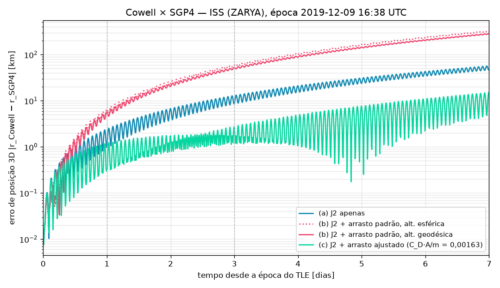
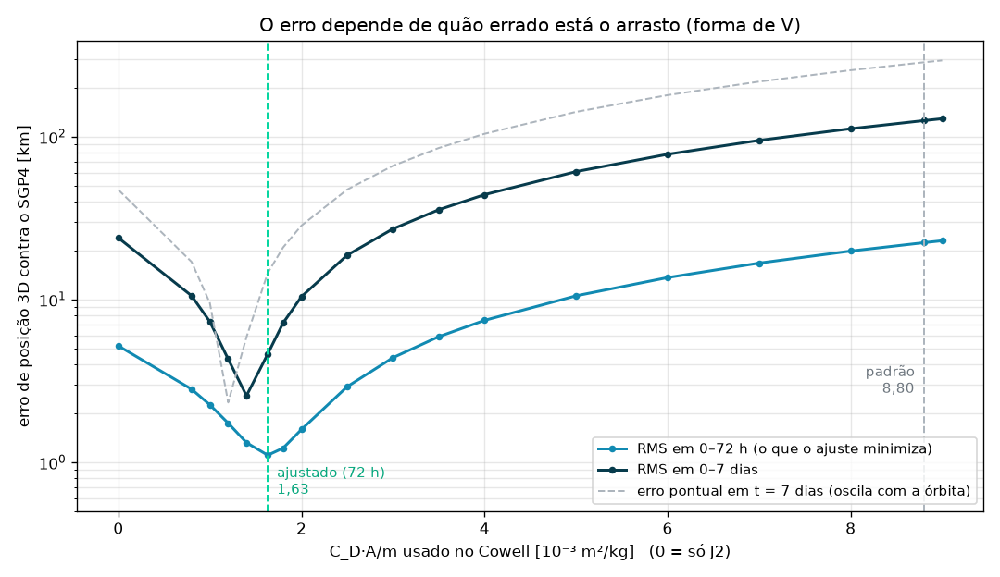

# Relatório do S3-03 — Cowell (J2 + arrasto) × SGP4

Gerado por `python scripts/compare_sgp4_cowell.py` em 56 s (ajuste: 11 s). TLE: ISS (ZARYA) (catálogo 25544), época 2019-12-09 16:38:29 UTC. Todas as configurações partem do estado do SGP4 em t = 0; Cowell DOP853 (rtol = 1e-10, atol = 1e-3); atmosfera exponencial por partes de Vallado (`satsim.forces.atmosphere`), co-rotante. Referência: Apêndice A.5 do prompt da Semana 3.

## Erro de posição 3D contra o SGP4

| Configuração | C_D·A/m [m²/kg] | 24 h [km] | 72 h [km] | 7 dias [km] | A.5 (24 h / 72 h / 7 d) |
|---|---:|---:|---:|---:|---|
| (a) J2 apenas | 0,00000 | 1,0 | 8,7 | 47,2 | 1 / 8,7 / 47 |
| (b) J2 + arrasto padrão, alt. esférica | 0,00880 | 6,6 | 59,6 | 325,2 | 6,6 / 59,6 / 325 |
| (b) J2 + arrasto padrão, alt. geodésica | 0,00880 | 5,8 | 52,4 | 286,1 | 5,8 / 52,4 / 286 |
| (c) J2 + arrasto ajustado (C_D·A/m = 0,00163) | 0,00163 | 0,3 | 2,7 | 14,5 | 0,3 / 2,7 / 14,5 |

**C_D·A/m ajustado:** 0,00163 m²/kg (janela de 72 h, amostras a cada 600 s, mínimos quadrados no RMS do erro de posição). Com C_D = 2,2 equivale a A/m = 0,00074 m²/kg. Referência A.5: 0,00163; faixa aceita: 0,0005 a 0,005.

**Critério do card (ajustado ≤ 2 / 8 / 40 km):** 0,3 / 2,7 / 14,5 km → OK.

## O erro em função do C_D·A/m: um “V”

Seria natural esperar que acrescentar arrasto sempre aproximasse o Cowell do SGP4. A varredura abaixo mostra que não: o Cowell (J2 + arrasto, altitude geodésica) foi rodado com vários valores de C_D·A/m, do zero (só J2) ao padrão. As duas primeiras colunas são o RMS do erro numa janela (variam suavemente); as três últimas, o erro num instante exato (oscilam com a órbita, como no gráfico acima).

| C_D·A/m usado [m²/kg] | RMS 0–72 h [km] | RMS 0–7 d [km] | 24 h [km] | 72 h [km] | 7 dias [km] |
|---|---:|---:|---:|---:|---:|
| 0,00000 (só J2) | 5,19 | 23,88 | 1,0 | 8,7 | 47,2 |
| 0,00080 | 2,81 | 10,54 | 0,4 | 3,1 | 17,0 |
| 0,00100 | 2,25 | 7,30 | 0,2 | 1,8 | 9,5 |
| 0,00120 | 1,74 | 4,30 | 0,1 | 0,5 | 2,3 |
| 0,00140 | 1,32 | 2,56 | 0,2 | 1,1 | 5,9 |
| 0,00163 (**ajustado**) | **1,11** | 4,63 | 0,3 | 2,7 | 14,5 |
| 0,00180 | 1,22 | 7,17 | 0,4 | 3,9 | 20,9 |
| 0,00200 | 1,59 | 10,40 | 0,6 | 5,2 | 28,4 |
| 0,00250 | 2,91 | 18,72 | 1,0 | 8,7 | 47,3 |
| 0,00350 | 5,91 | 35,57 | 1,7 | 15,6 | 85,1 |
| 0,00500 | 10,53 | 60,96 | 2,9 | 26,0 | 141,9 |
| 0,00880 (padrão) | 22,32 | 125,46 | 5,8 | 52,4 | 286,1 |

Em todas as colunas o erro tem forma de **V**: acrescentar arrasto ajuda enquanto a quantidade se aproxima da certa; passando dela, o erro volta a crescer, e rápido. O que importa é **quão errado está o arrasto**, não se ele está presente:

- **Só J2** erra para *menos*: falta arrasto (0 em vez de ≈ 0,0016); RMS de 23,9 km em 7 dias.
- **O arrasto padrão** erra para *mais*: 0,0088, cerca de 5,4 vezes o arrasto que o SGP4 “enxerga”; RMS de 125,5 km em 7 dias.

Errar para mais por esse fator é pior do que não ter arrasto algum: um valor só ≈ 50% acima do ajustado (0,0025) já empata com o caso sem arrasto no erro em 7 dias.

**Onde fica o mínimo depende da janela.** O RMS em 0–72 h, que é o que `fit_ballistic_coefficient` minimiza, tem o mínimo no valor ajustado (0,00163, 1,11 km). Em 0–7 dias o melhor valor é outro (≈ 0,0014, RMS de 2,56 km contra 4,63 km do ajustado). E os erros pontuais (24 h, 72 h, 7 dias) oscilam com a fase da órbita, então o seu mínimo pode cair ao lado do ajustado. Se o arrasto fosse o único erro do modelo, todas as janelas apontariam para o mesmo valor; como não apontam, o C_D·A/m ajustado é um parâmetro *efetivo*, que também compensa o que o Cowell não tem (ver a seção seguinte).

**Por que o erro de arrasto cresce tão depressa.** O arrasto tira energia, a órbita baixa e uma órbita mais baixa tem período menor: o satélite *adianta* ao longo da trajetória. O semieixo cai de forma aproximadamente linear no tempo, mas o adiantamento acumula essa diferença de velocidade angular, de modo que o erro ao longo da órbita cresce com o **quadrado do tempo**. Um erro pequeno em C_D·A/m vira centenas de km em uma semana.

**Por que o SGP4 “vê” tão pouco arrasto.** O arrasto do SGP4 vem do **B\*** do TLE, que o NORAD ajustou às medições de radar daquela semana. Em dezembro de 2019 a atividade solar estava no mínimo, a termosfera estava contraída e o arrasto real era fraco; o B\* registra isso. A tabela de Vallado representa atividade *moderada*: não sabe que era mínimo solar e põe muito mais ar a 400 km do que havia (ver a seção seguinte).

**Com o valor certo, o arrasto ajuda.** Com o C_D·A/m ajustado o RMS em 7 dias cai de 23,9 km (só J2) para 4,6 km, 5,2 vezes menos. Mais física deixa o modelo mais fiel *se os parâmetros forem certos*; com parâmetros genéricos, um modelo mais completo pode ser pior do que um mais simples.

## Por que o arrasto padrão piora o resultado

Com os parâmetros padrão (C_D = 2,2, A/m = 0,004) o Cowell fica **mais longe** do SGP4 do que só com J2: 5,8 / 52,4 / 286,1 km contra 1,0 / 8,7 / 47,2 km em 24 h / 72 h / 7 dias. Não é erro de código: o arrasto está implementado e validado contra o Sem3 (1,2e-6 m/s² a 400 km, −11,8 m por revolução, Tabela 3 e tempos de vida). O problema é o *valor* do arrasto:

- **Mínimo solar.** Dezembro de 2019 foi o fundo do mínimo do ciclo solar 24/25. Com pouca radiação EUV a termosfera esfria e se contrai, e a densidade a 400 km fica várias vezes abaixo da média. A tabela de Vallado representa atividade solar *moderada* (Sem3 Tabela 3: ρ varia por fatores de 5 a 10 ao longo do ciclo), então superestima o arrasto real daquela semana.
- **A/m efetivo da ISS.** A área frontal depende da atitude e da orientação dos painéis solares, que giram para seguir o Sol; 0,004 m²/kg é um valor nominal.
- **O que o ajuste absorve.** O C_D·A/m ajustado (0,00163, cerca de 19% do padrão) é um parâmetro *efetivo*: compensa a atmosfera do dia, a atitude e também parte do que o Cowell não modela e o SGP4 sim (J3, J4 e, em menor grau, Sol e Lua). Por isso o erro ajustado não vai a zero e cresce com o tempo.

A diferença entre as linhas esférica e geodésica do arrasto padrão vem da altitude usada na densidade: medida sobre o elipsoide WGS84, a altitude da ISS é maior que pela esfera de raio R⊕ (de 0 no equador a ≈ 13 km nas latitudes máximas, 51,6°), e a densidade ali é menor, então o arrasto geodésico é um pouco mais fraco.

**Lição:** um modelo de arrasto correto com parâmetros genéricos pode ser pior do que nenhum arrasto. Na prática, operadores ajustam um coeficiente balístico efetivo contra dados de rastreio (Sem3 §7, item 4), exatamente o que `fit_ballistic_coefficient` faz aqui com o SGP4 no lugar dos radares. A observação sobre atividade solar volta no documento da Semana 3.

## Fora do escopo

- Atmosferas empíricas (NRLMSISE-00, JB2008) e variação com o índice F10.7.
- Tempestades geomagnéticas.
- J3/J4 e atração lunissolar no Cowell.
