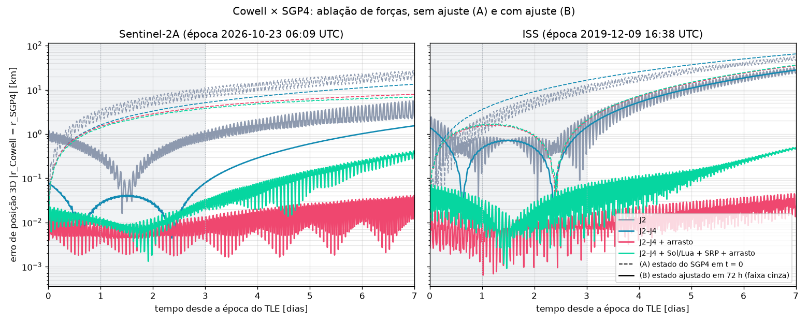

# Relatório do S4-06 — Cowell de alta fidelidade × SGP4

Gerado por `python scripts/compare_high_fidelity.py` em 11.9 min. Cowell DOP853 (rtol = 1e-10, atol = 1e-3); J2–J4 = `ZonalAcceleration`; arrasto com a atmosfera exponencial de Vallado, altitude geodésica e co-rotação; Sol e Lua pelas efemérides analíticas (`satsim.ephemeris`); SRP com C_R = 1,3, A/m = 0,01 m²/kg e sombra cilíndrica. Referência: Apêndice A.8 do prompt da Semana 4 (entre parênteses nas tabelas). Erros em km, instantâneos em 24 h / 72 h / 7 dias.

- **(A)** Cowell a partir do estado do SGP4 em t = 0 (método da Semana 3). Com arrasto, C_D·A/m ajustado ao RMS de 72 h numa busca limitada a [0; 0,03] m²/kg.
- **(B)** Estado inicial (6 parâmetros) e, com arrasto, C_D·A/m ajustados por mínimos quadrados às posições do SGP4 a cada 600 s em 72 h (`fit_initial_state`). Sem arrasto, só os 6 do estado.

## Sentinel-2A

TLE: `tests/data/sentinel2a_sample.tle`, época 2026-10-23 06:09:26+00:00 UTC.

| Forças | (A) 24 h / 72 h / 7 d | C_D·A/m (A) | (B) 24 h / 72 h / 7 d | C_D·A/m (B) | RMS 72 h (B) [km] | Tempo (B) |
|---|---|---:|---|---:|---:|---:|
| J2 | 2,12 / 10,11 / 18,40 (2,12 / 10,11 / 18,40) | — | 0,35 / 0,89 / 2,36 (0,76 / 1,58 / 3,20) | — | 0,549 (1,06) | 8 s |
| J2–J4 | 1,60 / 5,12 / 13,41 (1,60 / 5,12 / 13,41) | — | 0,03 / 0,08 / 1,54 (0,06 / 0,11 / 1,72) | — | 0,036 (0,051) | 22 s |
| J2–J4 + arrasto | 1,48 / 4,11 / 7,91 (1,48 / 4,11 / 7,91) | 0,03000 \* | 0,00 / 0,01 / 0,03 (0,05 / 0,09 / 1,44) | 0,01399 (0,00220) | 0,007 (0,043) | 72 s |
| J2–J4 + Sol/Lua + SRP + arrasto | 1,39 / 3,77 / 6,77 (1,39 / 3,77 / 6,77) | 0,03000 \* | 0,01 / 0,02 / 0,36 (0,06 / 0,09 / 1,11) | 0,01383 (0,00208) | 0,014 (0,048) | 92 s |

**Critério do card, (B) com forças completas (≤ 0,2 / 0,3 / 3 km):** 0,01 / 0,02 / 0,36 km → OK.

## ISS

TLE: `tests/data/iss_sample.tle`, época 2019-12-09 16:38:29+00:00 UTC.

| Forças | (A) 24 h / 72 h / 7 d | C_D·A/m (A) | (B) 24 h / 72 h / 7 d | C_D·A/m (B) | RMS 72 h (B) [km] | Tempo (B) |
|---|---|---:|---|---:|---:|---:|
| J2 | 0,98 / 8,66 / 47,18 (0,98 / 8,66 / 47,18) | — | 0,14 / 0,46 / 24,55 (0,39 / 1,03 / 26,72) | — | 0,824 (0,97) | 9 s |
| J2–J4 | 3,58 / 16,44 / 64,98 (3,58 / 16,44 / 64,98) | — | 0,48 / 1,42 / 28,03 (0,93 / 2,29 / 31,53) | — | 0,641 (0,94) | 15 s |
| J2–J4 + arrasto | 1,54 / 1,97 / 35,41 (1,54 / 1,97 / 35,41) | 0,00266 | 0,01 / 0,01 / 0,02 (0,13 / 0,25 / 3,60) | 0,00123 (0,00137) | 0,008 (0,109) | 91 s |
| J2–J4 + Sol/Lua + SRP + arrasto | 1,60 / 2,05 / 36,35 (1,60 / 2,05 / 36,35) | 0,00268 | 0,03 / 0,06 / 0,49 (0,14 / 0,29 / 3,39) | 0,00119 (0,00134) | 0,030 (0,128) | 138 s |

**Critério do card, (B) com forças completas (≤ 0,5 / 1 / 8 km):** 0,03 / 0,06 / 0,49 km → OK.

\* C_D·A/m de (A) parou no limite superior da busca (0,03): o arrasto estava absorvendo o erro do estado inicial, não descrevendo a atmosfera.

Linhas tracejadas: (A); contínuas: (B). A faixa cinza é a janela do ajuste (72 h); depois dela, (B) é previsão.

## Por que (A) tem piso e (B) não

O SGP4 é uma teoria analítica truncada: o estado que ele dá na época já erra ≈ 1 km contra a órbita que ele próprio descreve nos dias seguintes. Partindo desse estado, o Cowell herda o erro, e o pior componente é o do **semieixo**: alguns metros de erro em a mudam o período e viram uma deriva ao longo da órbita que cresce linearmente com o tempo. Nenhuma força a mais remove esse erro, porque ele não vem da física que falta, vem da condição inicial. É o piso de (A): no Sentinel-2A, sair de J2 para o modelo completo reduz o erro em 7 dias só de 18,40 para 6,77 km.

Em (B) o estado inicial é escolhido para que a trajetória inteira de 72 h fique o mais perto possível do SGP4, o que corrige o semieixo médio. O que sobra é a diferença de **modelo** entre o Cowell e o SGP4, e aí cada força a mais aparece. No Sentinel-2A, J3 e J4 levam o erro em 24 h de 0,35 para 0,03 km. Na ISS, mais baixa, quem domina é o arrasto: sem ele o ajuste não consegue representar a queda do semieixo, e o erro em 7 dias fica em 28,03 km; com ele cai para 0,02 km.

**O C_D·A/m ajustado é efetivo.** Em (A) o arrasto também compensa o erro do estado inicial: no Sentinel-2A, a 786 km, o C_D·A/m de (A) vai para o limite da busca. Em (B) os dois papéis se separam e ele deixa de bater no limite. Na ISS o valor de (B) (0,00119 m²/kg) fica perto do A.8 e do ajuste da Semana 3 (0,00163). No Sentinel-2A sai 0,01383 m²/kg, contra 0,00208 do A.8: a 786 km a tabela de Vallado e o modelo de densidade do próprio SGP4 (uma lei de potência fixa, escalada pelo B\* do TLE) não têm por que concordar, e o ajuste escolhe o coeficiente que reproduz o decaimento que o *SGP4* aplica. É um parâmetro efetivo em relação ao oráculo, não o C_D·A/m físico do satélite.

## Diferenças em relação ao A.8

Os erros de (A) reproduzem o A.8 nos 8 casos. Em (B) o satsim chega a erros e RMS **menores** que os do A.8 em todos os casos (RMS entre parênteses na tabela; ex.: Sentinel-2A J2–J4 + arrasto 0,007 km contra 0,043 km; ISS 0,008 km contra 0,109 km). Como o RMS de 72 h é exatamente o que o ajuste minimiza, um RMS menor com o mesmo modelo indica que o otimizador do experimento parou antes do mínimo. A causa provável é o passo das diferenças finitas: com passo relativo pequeno (≈ 1e-6, 1 mm em r0) o Jacobiano fica dominado pelo ruído da integração e o `least_squares` para cedo; no ajuste sintético do satsim, esse passo deixava o estado a 0,33 m do certo, contra 1,3 mm com o passo usado (1e-4: 0,1 m em r0, 0,1 mm/s em v0). Os critérios do card passam com folga nos dois casos.

## Por que o SGP4 não valida Sol/Lua

Para órbitas com período abaixo de 225 min (LEO, caso dos dois satélites) o SGP4 **não tem** atração lunissolar: ela só entra no SDP4, a variante de espaço profundo. O SGP4 também não tem SRP. Então, contra o SGP4, acrescentar Sol, Lua e SRP ao Cowell só pode piorar o acordo ou deixá-lo igual: o Cowell completo fica mais perto da órbita real e mais longe do oráculo. É o que a tabela mostra em (B): em 7 dias, a linha J2–J4 + arrasto erra 0,03 km no Sentinel-2A e 0,02 km na ISS; com Sol, Lua e SRP, 0,36 e 0,49 km. Mais física, acordo pior: a assinatura de forças que o oráculo não tem. Validar Sol e Lua exige uma referência que os tenha: efemérides de precisão (SP3 de GNSS a bordo, como as do Sentinel-2) ou um propagador numérico de referência. Neste projeto eles foram validados por componentes no S4-02 (posições contra DE421 e aceleração contra valores independentes, Apêndice A.3).

## Fora do escopo

- Atmosfera com F10.7 e Ap, harmônicos tesserais, penumbra, manobras.
- Referências de precisão (SP3/GNSS) no lugar do SGP4.
