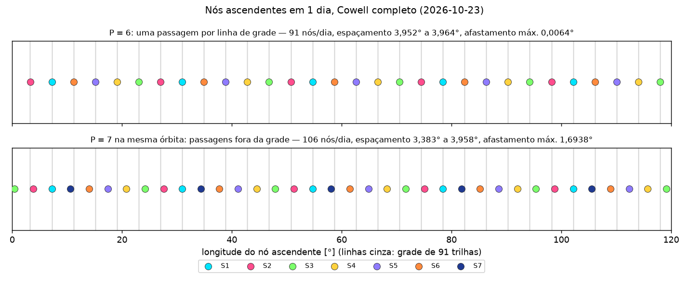
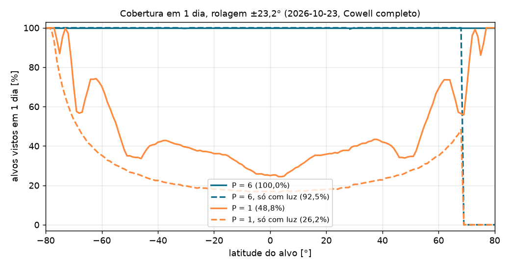
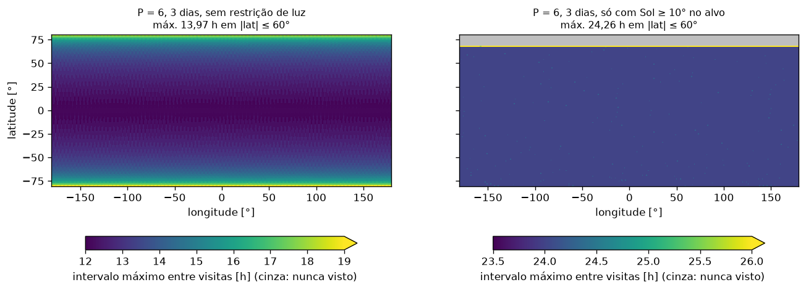
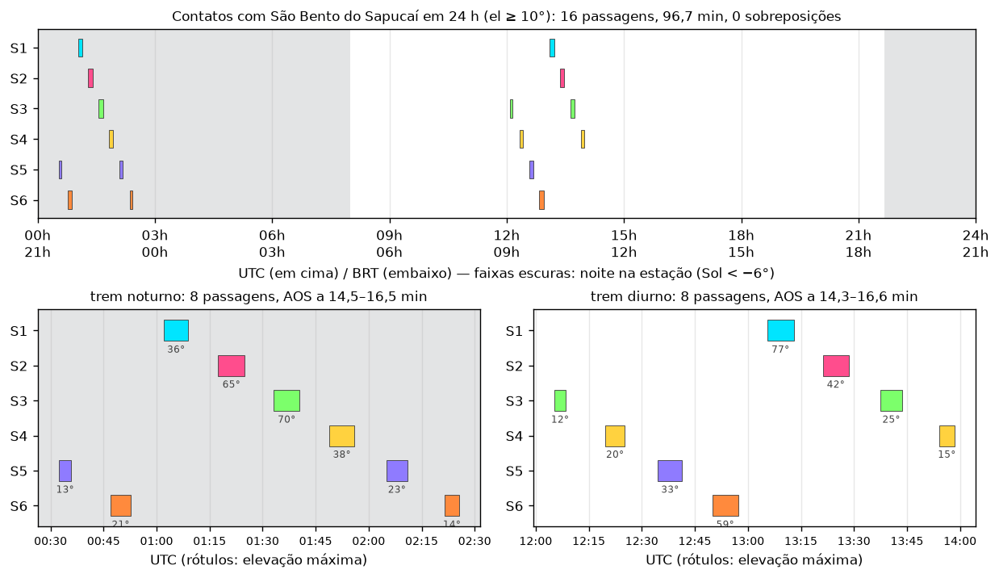

# Relatório da Semana 5 — Constelação 91/6

Gerado por `python scripts/constellation_report.py`. Época 2026-10-23 00:00 UTC. Constelação de referência do Apêndice A.1 do prompt da Semana 5 (`sso_constellation`: a 6 888,089 km, e congelada, i 97,46325°, ω 90°, LTAN 22h30, ψ0 = 0°, 300°, …, 60°). Cowell completo = J2–J4 + Sol/Lua + SRP (C_R 1,3, A/m 0,01 m²/kg) + arrasto (C_D·A/m 0,011 m²/kg, geodésico). Valores do Apêndice entre parênteses.

## S5-02 · Grade de 91 trilhas e repetição

### Grade no equador

Nós por `node_crossings` (interpolação linear da latitude, passo 30 s); métricas por `grid_metrics` (espaçamentos com a volta de 360°; afastamento à grade ideal de 360°/91 = 3,95604°, ancorada no 1º nó de S1).

| Caso | Nós | Espaçamento mín. … máx. [°] | Afastamento máx. [°] |
|---|---:|---|---:|
| Modelo médio, P = 1, 6 dias | 91 | 3,95599 … 3,95627 (91; 3,9560 uniforme) | 0,0003  |
| Modelo médio, P = 6, 1 dia | 91 | 3,95600 … 3,95606 (91; 3,9560 uniforme) | 0,0000  |
| Modelo médio, P = 7, 1 dia | 107 | 0,56511 … 3,39090 (107; 0,5651 … 3,3909) | 1,6955  |
| Cowell completo, P = 6, 1 dia | 91 | 3,95173 … 3,96432 (91; 3,95173 … 3,96431) | 0,0064 (0,0064) |
| Cowell completo, P = 1, 6 dias (91 primeiros) | 91 | 3,91683 … 3,96738 (3,9169 … 3,9674) | 0,0414  |
| Cowell completo, P = 7, 1 dia | 106 | 3,38337 … 3,95848 (106; 3,3834 … 3,9585) | 1,6938 (1,694) |

- **Teorema P = D (Sem4 §8.3) no Cowell completo:** seis satélites em um dia depositam as 91 trilhas, com espaçamentos a ±0,006° do ideal; sete satélites na mesma órbita deixam a grade (afastamento de 1,7°, 6/7 de passo), com quase-duplicatas e lacunas mantidas.
- **Modelo médio:** com 1 satélite em 6 dias o passo varia 0,000285°. Não é a teoria: o ECEF gira com o GMST real, 8,554e-12 rad/s mais rápido que o ω⊕ = 7,292115e-5 rad/s do Sem4, o que desloca a grade em 0,000254° (≈ 28 m) em 6 dias.
- **Afastamento no Cowell (P = 6):** os desvios à grade têm padrão de período 3 (S1/S4, S2/S5, S3/S6, ±0,0045°): é o termo de curto período de J2 em Ω e u, que a conversão médio → osculador (S4-04) não corrige (ela ajusta a, o vetor e e i). Ancorado no 1º nó no tempo (o de S3), o afastamento máximo seria 0,0107°.
- **Precisão do nó:** contra nós refinados por `brentq` em z_ECI = 0 (S1, 15 nós em 24 h), a interpolação linear erra 7,3e-5° / 1,1e-3 s com passo de 60 s, 9,3e-6° / 2,7e-4 s com 30 s e 5,2e-7° com 10 s (`tests/test_repeat_grid.py`; A.3: 7,3e-5°, 9,3e-6°, 4,8e-7°). O refinamento por `brentq` não é necessário.

### Repetição de 6 dias e semieixo calibrado

`repeat_semi_major_axis_calibrated` (Cowell J2–J4, conversão só zonal): secante em a até N·Tnod = D·Tdia,nod, Tnod pelo ajuste linear dos nós e Tdia,nod = 2π/(ω⊕ − Ω̇) com Ω̇ por `fit_rate`. Resultado: **a = 6 888 108,37 m, Δa = +19,37 m** (A.4: 6 888 108,37 m, +19,37 m), em 3,6 s.

| Forças | a | Fechamento após 91 voltas | N·Tnod − D·Tdia,nod [s] | Tnod [s] | Ω̇ [°/d] |
|---|---|---|---:|---:|---:|
| J2–J4 | projeto | 0,00895° = 0,996 km (+0,00895° = 1,00 km) | −2,1973 | 5 696,6796 | 0,985632 |
| J2–J4 | calibrado | −0,00020° = −0,022 km (−0,00020° = −0,022 km) | 0,0000 | 5 696,7036 | 0,985622 |
| completo (com arrasto) | projeto | 0,04223° = 4,701 km (+0,0422° = 4,69 km) | −10,2042 | 5 696,5900 | 0,985531 |
| completo (com arrasto) | calibrado | 0,03306° = 3,680 km (+0,0330° = 3,68 km) | −8,0043 | 5 696,6140 | 0,985521 |

- **Fechamento com o a calibrado (J2–J4):** o resíduo de −22 m é, na maior parte, a mesma diferença ω⊕ × GMST real do modelo médio (−28 m previstos em 6 dias): a calibração usa o ω⊕ do Sem4 em Tdia,nod, como pede o card.
- **Com arrasto o ciclo não fecha** mesmo com o a calibrado (≈ 3,7 km por ciclo): é a deriva quadrática do Sem4 §7.6, assunto do S5-05. A calibração é feita sem arrasto, como a da inclinação.
- **Efeito no LTAN:** Δa = +19 m muda Ω̇ por Ω̇ ∝ a^(−7/2) (Sem4 eq. 32): −0,0142 min/ano (Sem4: −0,014). Medido no Cowell J2–J4 (diferença dos Ω̇ ajustados em 6 dias): −0,0142 min/ano. Desprezível diante da banda de ±5 min.

## S5-03 · Cobertura diária e revisita

Rolagem η = ±23,2°: alcance transversal λ = 1,9784° = 220,2 km (Sem4 eq. 45; A.5: 1,9784° = 220,2 km). A rolagem de meia grade (λ = π/91) é 23,1957° (A.5: 23,1957°). Alvos em |lat| ≤ 80° numa grade de 1° × 1°, passo de 10 s, constelação de referência no Cowell completo (`access_times`, `coverage_stats`); acessos a menos de 30 min contam como uma passagem.

| Caso | Alvos vistos |
|---|---:|
| P = 6, 1 dia | 100,00% (100%) |
| P = 1, 1 dia | 48,82% (48,48%) |
| P = 1, 6 dias | 100,00% (100%) |
| P = 6, 1 dia, só com luz | 92,55% |
| P = 1, 1 dia, só com luz | 26,17% |
| P = 6, 3 dias, só com luz | 92,55% (92,55%) |

- **A promessa da constelação:** com seis satélites e ±23,2° de rolagem, todo ponto entre ±80° é alcançado no mesmo dia; um satélite sozinho vê metade da Terra por dia e precisa do ciclo inteiro de 6 dias. A curva de P = 1 sobe perto de ±80°, onde as trilhas convergem e as faixas se sobrepõem.

### Revisita em 3 dias

| P = 6, 3 dias | Revisita máx. \|lat\| ≤ 60° | Revisita máx. \|lat\| ≤ 80° | Tempo sem acesso máx. \|lat\| ≤ 60° |
|---|---:|---:|---:|
| sem restrição de luz | 13,97 h (13,97 h) | 19,04 h (19,04 h) | 13,69 h |
| só com Sol ≥ 10° | 24,26 h (24,26 h) | 50,55 h (dos vistos) | 24,00 h |

- **Revisita × tempo sem acesso:** a revisita (`interval="revisit"`, a do A.5) vai do início de uma passagem ao início da seguinte; o tempo sem acesso (`"blackout"`) vai do fim de uma ao início da outra. A diferença é a duração da passagem: perto do equador, dois satélites vizinhos do trem (15,8 min) podem ver o mesmo alvo; em latitude alta, as faixas convergem e vários satélites, em voltas seguidas, o veem em sequência.
- **Sem luz: ≈ 12 a 14 h.** Cada alvo é visto duas vezes por dia, numa passagem ascendente (nó às 22h30 local) e numa descendente (10h30), a ≈ 12 h uma da outra. No equador a revisita máxima é ≈ 12,1 h; ela cresce com a latitude (≈ 14 h a ±60°, ≈ 19 h a ±80°) porque fora do equador as duas passagens deixam de ser simétricas: a hora local do sobrevoo se afasta de 10h30 e 22h30 em sentidos opostos, e o intervalo entre elas fica alternadamente mais curto e mais longo que 12 h.
- **Com luz: ≈ 24 h.** Uma câmera óptica só usa a passagem descendente, de manhã (10h30): a ascendente é noturna. Resta uma visita por dia, e a revisita dobra. Em outubro a declinação do Sol é −11,9°: ao meio-dia solar, ele fica abaixo de 10° de elevação para latitudes acima de 90° − 10° + δ ≈ 68,1° N. Nenhum alvo acima de ≈ 69° N é visto com luz: a fração cai para 92,55% (A.5: 92,55%). No hemisfério sul é o contrário: a primavera austral deixa o Sol alto, e com P = 1 a fração com luz sobe para perto de −80° (gráfico por latitude).

## S5-04 · Plano de contatos sobre São Bento do Sapucaí

`contact_plan` (estação −22,69°, −45,73°, 900 m; el ≥ 10°; 2026-10-23 00:00 UTC + 24 h; constelação de referência no Cowell completo). Dia/noite pela elevação do Sol na estação no TCA (crepúsculo civil, −6°); trens = passagens com AOS a menos de 30 min da anterior.

- **16 passagens** (S1 2, S2 2, S3 3, S4 3, S5 3, S6 3), **96,7 min** de contato, **0 sobreposições** (uma antena basta) — A.6: 16, 96,68 min, nenhuma.
- **Dois trens:** noturno de 21h32 a 23h25 BRT e diurno de 09h05 a 10h58 BRT (A.6: 21h32–23h25 e 9h05–10h58). O maior intervalo sem contato é de 10,03 h.

| # | Trem | Satélite | AOS (BRT) | El. máx. | Duração | Sol no TCA | Luz |
|---:|---:|---|---|---:|---:|---:|---|
| 1 | 1 | S5 | 21h32 | 12,8° | 3,5 min | −42,9° | noite |
| 2 | 1 | S6 | 21h46 | 21,4° | 5,9 min | −45,4° | noite |
| 3 | 1 | S1 | 22h01 | 36,0° | 7,0 min | −47,8° | noite |
| 4 | 1 | S2 | 22h17 | 65,2° | 7,5 min | −50,0° | noite |
| 5 | 1 | S3 | 22h33 | 69,6° | 7,5 min | −51,8° | noite |
| 6 | 1 | S4 | 22h48 | 38,5° | 7,0 min | −53,4° | noite |
| 7 | 1 | S5 | 23h04 | 23,0° | 6,0 min | −54,6° | noite |
| 8 | 1 | S6 | 23h21 | 14,1° | 4,0 min | −55,5° | noite |
| 9 | 2 | S3 | 09h05 | 12,3° | 3,1 min | 50,2° | dia |
| 10 | 2 | S4 | 09h19 | 20,1° | 5,6 min | 53,8° | dia |
| 11 | 2 | S5 | 09h34 | 33,2° | 6,8 min | 57,3° | dia |
| 12 | 2 | S6 | 09h49 | 59,0° | 7,4 min | 60,7° | dia |
| 13 | 2 | S1 | 10h05 | 76,9° | 7,5 min | 64,1° | dia |
| 14 | 2 | S2 | 10h21 | 42,0° | 7,2 min | 67,4° | dia |
| 15 | 2 | S3 | 10h37 | 24,5° | 6,2 min | 70,6° | dia |
| 16 | 2 | S4 | 10h54 | 14,8° | 4,4 min | 73,5° | dia |

### Por que as passagens chegam em trens de 15,8 min

Os seis satélites estão no **mesmo plano**, em fila, separados de 60° em argumento de latitude: cada um cruza qualquer ponto da órbita Tnod/6 = 5 696,7/6 s ≈ 15,8 min depois do anterior (Sem4 §8.5, Tabela 4). Nesse intervalo a Terra gira ≈ 3,96° (um passo da grade), então o satélite seguinte passa ≈ 440 km a oeste no equador (≈ 400 km na latitude de São Bento): ainda dentro do círculo de visibilidade da estação, que tem ≈ 1 590 km de raio para el ≥ 10° a 510 km (`footprint_half_angle`: 14,2°). Por isso a estação vê o trem passar inteiro, um satélite a cada ≈ 15,8 min (AOS a 14,3–16,6 min: o tempo entre AOS varia porque cada satélite corta o círculo numa corda diferente, as primeiras do trem perto de uma borda, as do meio perto do centro e as últimas perto da borda oposta). As passagens do meio do trem são as mais altas e longas; as das pontas, rasantes e curtas.

O plano orbital acompanha o Sol (SSO): o trem passa pela estação **duas vezes por dia**, na metade ascendente da órbita (nó às 22h30 local, de noite) e na descendente (10h30, de manhã), **sempre nos mesmos horários solares**. Entre os dois trens não há nenhum contato: as outras ≈ 13 voltas de cada satélite passam longe demais de São Bento.

