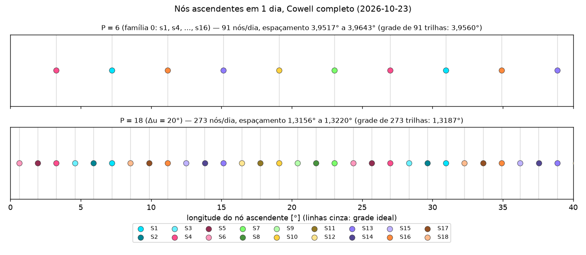
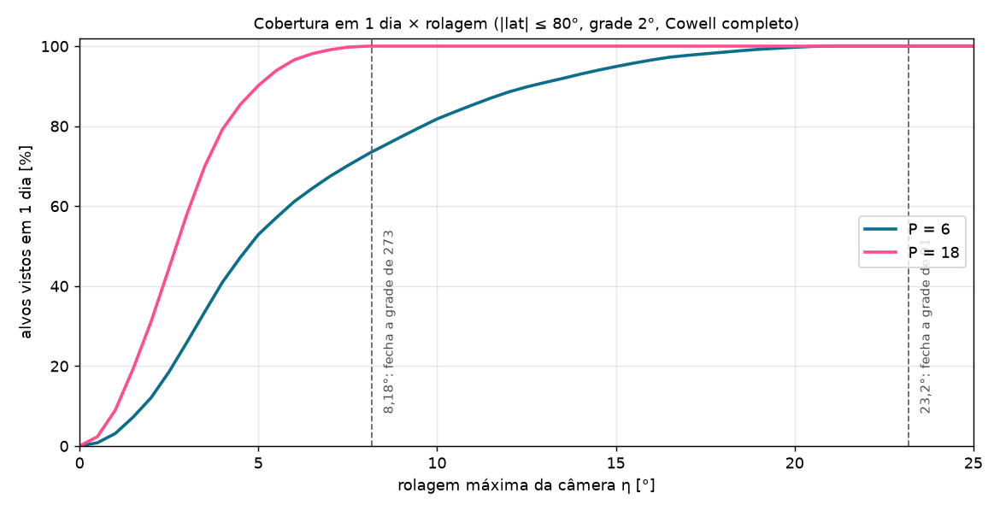
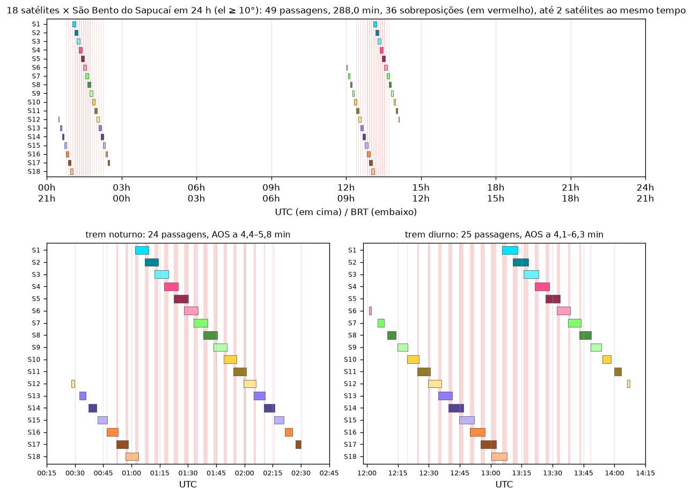

# Relatório da Semana 6 — Constelação de 18 satélites (P = 3·D)

Gerado por `python scripts/constellation_report.py --sats 18`. Época 2026-10-23 00:00 UTC. Mesma órbita da Semana 5 (a 6 888,089 km, i 97,46325°, LTAN 22h30, Cowell completo), agora com 18 satélites num único plano, Δu = 20° (`DESIGN_91_6_P18`: ψ0_j = −j·20°, ids s1 … s18 em ordem de fase). Os satélites s1, s4, …, s16 (família 0) ocupam as posições da constelação de 6. Valores do Apêndice A do prompt da Semana 6 entre parênteses.

## Em linguagem simples: o que 18 satélites compram

Com 6 satélites, a Terra recebe 91 riscos por dia, a cada 440 km no equador; a câmera precisa girar até 23,2° para os lados para enxergar o meio do vão entre dois riscos. Com 18 satélites no mesmo plano, cada novo satélite passa 5,3 min depois do vizinho da frente. Nesse tempo a Terra gira um terço do vão, então o novo risco cai **entre** os antigos: são 273 riscos por dia, a cada 147 km. A câmera só precisa girar 8,2°: imagem mais nítida (menos inclinada) e menos atmosfera no caminho.

O que **não** melhora é o tempo de espera por uma nova foto do mesmo lugar. Os 18 satélites andam em fila, como vagões de um trem: quando o trem passa perto de um alvo, dois ou três vagões vizinhos o enxergam, mas todos no intervalo de poucos minutos. Depois o trem só volta meio dia mais tarde, na outra metade da órbita, como acontecia com 6. Num plano só, todas as passagens acontecem no mesmo horário solar (22h30 e 10h30 locais).

## Grade de 273 trilhas

| Caso | Nós | Espaçamento mín. … máx. [°] | Afastamento máx. [°] |
|---|---:|---|---:|
| Modelo médio, P = 18 | 273 | 1,318641 … 1,318698 (1,31868 uniforme) | — |
| Cowell completo, P = 18 | 273 | 1,31556 … 1,32196 (273; 1,31556 … 1,32196) | 0,00695 (0,00695) |
| Cowell completo, família 0 (91 trilhas) | 91 | 3,95173 … 3,96432 (91; 3,95173 … 3,96432) | 0,00645 (0,00645) |
| Cowell completo, família 1 (91 trilhas) | 91 | 3,94821 … 3,96245 | 0,00785 |
| Cowell completo, família 2 (91 trilhas) | 91 | 3,94816 … 3,96240 | 0,00784 |

- **Atraso entre vizinhos:** 316,42 a 316,54 s (média 316,48 s; Tnod/18 = 316,5 s; A.1: s2 − s1 = 316,54 s). Primeiros nós: s1 4 274,46 s, s2 4 591,00 s, s3 4 907,52 s, s4 5 223,99 s (A.1: 4 274,46; 4 591,00; 4 907,52; 5 223,99). O s4 cruza o nó no mesmo instante que o S2 da constelação de 6: a família 0 **é** a constelação de 6.
- **Três famílias, três grades de 91:** f = j mod 3. Cada família é uma constelação 91/6 completa; as três se intercalam a 1/3 de passo (Sem4 eq. 43, D/P = 1/3). Os afastamentos à grade de 273 vêm do mesmo termo de curto período de J2 já visto na Semana 5 (±0,0045°).
- **Custo:** nós de 1 dia dos 18 em 20,1 s (A.1: 20,3 s), praticamente todo na integração do Cowell completo.

## Cobertura e revisita

Rolagem que fecha a grade diária (Sem4 eq. 45, λ = meia grade): **8,1835°** com 18 satélites e 23,1957° com 6 (A.2: 8,1835° e 23,1957°). Grade de alvos 2° × 2° em |lat| ≤ 80°, passo 10 s, Cowell completo; intervalo de revisita entre inícios de passagens (acessos a menos de 30 min fundidos), com as bordas da janela.

| Caso | Janela | Fração vista | Maior intervalo, \|lat\| ≤ 60° | \|lat\| ≤ 80° | A.3 (fração; \|lat\| ≤ 60°) |
|---|---|---:|---:|---:|---|
| P = 18, η = 8,18° | 3 dias | 100,00% | 24,00 h | 24,00 h | 100%; 24,0 h |
| P = 18, η = 23,2° | 3 dias | 100,00% | 13,79 h | 18,95 h | 100%; 13,79 h |
| P = 6, η = 23,2° | 3 dias | 100,00% | 13,97 h | 19,04 h | 100%; 13,97 h |
| P = 6, η = 8,18° | 3 dias | 74,35% | 72,00 h | 72,00 h | 74,35%; 72,0 h |

- **1 dia com 8,18°:** P = 18 vê 100,00% dos alvos; P = 6, só 73,6%. A curva de P = 18 chega a 100% com um terço da rolagem de P = 6.
- **Redundância:** tirando qualquer um dos 18, os 17 restantes com 23,2° ainda cobrem 100,00% em 1 dia (pior caso entre as 18 remoções). Com 23,2°, cada alvo fica ao alcance de 3 trilhas por dia (λ = 1,98° = 1,5 grade diária).
- **Revisita:** 13,79 h com 18 contra 13,97 h com 6 (|lat| ≤ 60°): praticamente igual.

### Por que a revisita não cai: a discrepância com o Sem4 §8.3

O Sem4 §8.3 diz que, com P = m·D, cada trilha recebe **m passagens por dia**. Medido no Cowell, não é o que acontece com P = 18: os 18 depositam **273 trilhas diferentes**, uma passagem em cada (a grade fica 3× mais densa), e não 3 passagens sobre as mesmas 91. O que um alvo recebe, com η = 23,2° e |lat| ≤ 60° em 1 dia:

| | P = 6 | P = 18 |
|---|---:|---:|
| Passagens (acessos a < 30 min fundidos): mín. / mediana / máx. | 2 / 2 / 3 | 2 / 2 / 3 (A.3: 2 / 2 / 3) |
| Passagens contadas satélite a satélite (sem fundir o trem): mín. / mediana / máx. | 2 / 2 / 5 | 6 / 7 / 13 |
| Duração de uma passagem fundida (1º ao último acesso), mediana / máx. | 1,0 / 141,5 min | 16,2 / 151,7 min |

Com 18, há 3× mais oportunidades de satélite por alvo, mas elas chegam no **mesmo trem**: satélites vizinhos, a 5,3 min um do outro, veem o alvo um atrás do outro, numa janela de 16 min na mediana (A.3: ≈ 10 min; a diferença é a definição: aqui, do 1º ao último acesso da passagem fundida, que em latitude alta junta mais satélites e chega a horas). Contadas como passagens (o que importa para a revisita), continuam sendo 2 por dia, uma na metade ascendente e outra na descendente da órbita, sempre no mesmo horário solar. Por isso o maior intervalo entre visitas fica em ≈ 14 h. Para encurtá-lo seria preciso espalhar os satélites em **três planos com LTAN diferentes** (passagens em horários solares distintos), o que fica fora do escopo: o desenho do Sem4 é de plano único.

## Contatos com São Bento do Sapucaí

- **49 passagens**, **287,99 min** de contato em 24 h (A.4: 49 e 287,99 min); com 6 satélites (família 0), 16 passagens e 96,68 min (A.6 da S5: 16 e 96,68).
- **Dois trens:** noite 00:28–02:30 UTC (24 passagens) e dia 12:01–14:07 UTC (25) (A.4: 00:28–02:30, 24; 12:01–14:07, 25). AOS consecutivos a 4,1–6,3 min (≈ Tnod/18 = 5,3 min; A.4: 4,1 … 6,3).
- **36 sobreposições, até 2 satélites ao mesmo tempo** (A.4: 36; 2). Uma passagem dura até ≈ 7,5 min e o próximo satélite chega 5,3 min depois: dentro de um trem, quase toda passagem se sobrepõe à seguinte. Com uma antena só, seria preciso escolher um satélite por vez (priorização); com duas, todos são atendidos. O escalonamento não foi implementado, só quantificado.
- **Maior intervalo sem contato:** 9,88 h (A.4: 9,88 h), entre os dois trens: os satélites extras alongam os trens, mas não criam contatos fora deles.

## Manutenção

ȧ medido em 1 dia nos 18 satélites: −24,02 a −23,95 m/dia, o mesmo dos 6 (−23,95 m/dia; mesmo semieixo, mesmo arrasto). O `MaintenanceStatus` de cada um é igual ao da Semana 5 a menos de 1%: o custo por satélite não muda, o da constelação triplica (≈ 18 manobras do traço por semana, uma por satélite).

