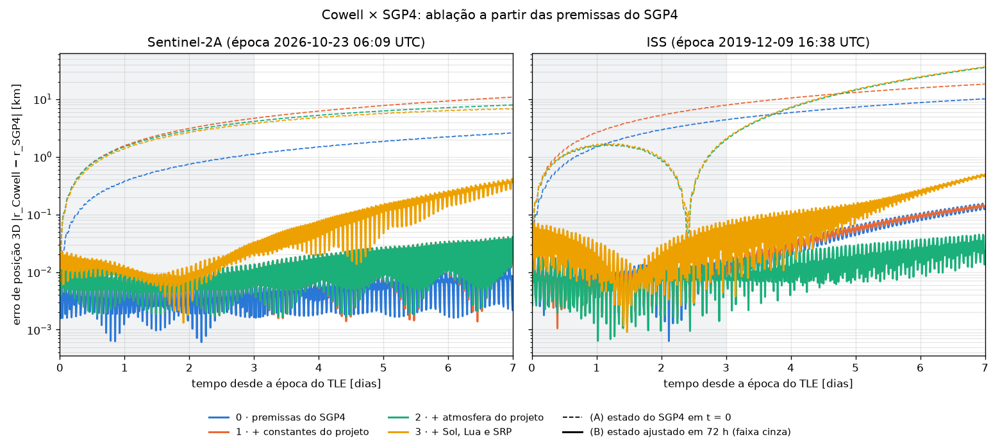

# Cowell equivalente ao SGP4: ablação a partir das premissas do SGP4

Gerado por `python scripts/compare_sgp4_equivalent.py` em 12.9 min. Cowell DOP853 (rtol = 1e-10, atol = 1e-3) contra o SGP4 dos TLEs de teste, 7 dias a cada 600 s. Erros de posição 3D instantâneos em 24 h / 72 h / 7 dias.

**Pergunta.** Quando o Cowell assume exatamente a mesma física que o SGP4, ele recupera o SGP4? Se sim, a diferença que sobra na ablação do S4-06 é física (o que um modelo tem e o outro não), e não erro do integrador.

Passos (cada um acrescenta uma diferença ao anterior):

0. **Premissas do SGP4** (`satsim.sgp4_equivalent`): zonais J2–J4 e µ do WGS-72; arrasto com a atmosfera de lei de potência do SGP4, ρ ∝ [(q0 − s)/(r − s)]⁴ (q0 = R⊕ + 120 km, s = R⊕ + 78 km), esférica, sem co-rotação, intensidade dada pelo B\* do TLE; sem Sol, Lua e SRP.
1. **Constantes do projeto**: µ, R⊕ e J2–J4 de `satsim.constants` no lugar dos do WGS-72; o mesmo arrasto do B\*.
2. **Atmosfera do projeto**: exponencial de Vallado, altitude geodésica e co-rotação, com C_D·A/m ajustado (é o "J2–J4 + arrasto" do S4-06).
3. **+ Sol, Lua e SRP** (C_R = 1,3, A/m = 0,01 m²/kg; é o "completo" do S4-06).

Métodos: **(A)** estado do SGP4 em t = 0; **(B)** estado inicial ajustado por mínimos quadrados às posições do SGP4 em 72 h (`fit_initial_state`). O C_D·A/m é ajustado só nos passos 2 e 3; nos passos 0 e 1 o arrasto é o do B\*, sem parâmetro livre.

## Sentinel-2A

TLE: `tests/data/sentinel2a_sample.tle`, época 2026-10-23 06:09:26+00:00 UTC, B\* = 4,4317e-05 /ER, perigeu ≈ 788 km.

| Passo | (A) 24 h / 72 h / 7 d | (B) 24 h / 72 h / 7 d | RMS 72 h (B) | C_D·A/m (B) [m²/kg] |
|---|---|---|---:|---:|
| 0 · premissas do SGP4 | 378 m / 1,11 km / 2,60 km | 3 m / 2 m / 9 m | 4 m | B\* do TLE |
| 1 · + constantes do projeto | 1,54 km / 4,65 km / 10,85 km | 4 m / 10 m / 34 m | 7 m | B\* do TLE |
| 2 · + atmosfera do projeto | 1,48 km / 4,11 km / 7,91 km | 4 m / 10 m / 34 m | 7 m | 0,01399 |
| 3 · + Sol, Lua e SRP | 1,39 km / 3,77 km / 6,77 km | 10 m / 20 m / 361 m | 14 m | 0,01383 |

## ISS

TLE: `tests/data/iss_sample.tle`, época 2019-12-09 16:38:29+00:00 UTC, B\* = 3,8792e-05 /ER, perigeu ≈ 411 km.

| Passo | (A) 24 h / 72 h / 7 d | (B) 24 h / 72 h / 7 d | RMS 72 h (B) | C_D·A/m (B) [m²/kg] |
|---|---|---|---:|---:|
| 0 · premissas do SGP4 | 1,47 km / 4,40 km / 10,14 km | 11 m / 12 m / 128 m | 9 m | B\* do TLE |
| 1 · + constantes do projeto | 2,63 km / 7,86 km / 18,23 km | 10 m / 10 m / 137 m | 9 m | B\* do TLE |
| 2 · + atmosfera do projeto | 1,54 km / 1,97 km / 35,41 km | 10 m / 7 m / 23 m | 8 m | 0,00123 |
| 3 · + Sol, Lua e SRP | 1,60 km / 2,05 km / 36,35 km | 32 m / 64 m / 490 m | 30 m | 0,00119 |

Linhas tracejadas: (A); contínuas: (B). A faixa cinza é a janela do ajuste (72 h); depois dela, (B) é previsão.

## O integrador recupera o SGP4

Com as mesmas premissas (passo 0) e o estado ajustado, o Cowell fica a 4 m (RMS em 72 h) do SGP4 no Sentinel-2A e a 9 m na ISS, e em 7 dias, já fora da janela do ajuste, a 9 m e 128 m. É o resultado esperado de duas soluções das mesmas equações: o que sobra é a truncagem da teoria analítica do SGP4 (J2 de 1ª ordem nos termos de curto período, J3 só no longo período, J4 só no secular, arrasto só como deriva secular), e não erro do integrador. Na ISS, a ≈ 410 km, o resíduo de 7 dias é maior porque o arrasto, que o SGP4 trata de forma mais aproximada que a gravidade, pesa mais.

No método (A) o passo 0 também é o melhor (Sentinel-2A em 7 dias: 2,60 km, contra 10,85 km no passo 1), mas continua com o piso do S4-06: o estado osculador que o SGP4 entrega em t = 0 é uma série truncada, e o erro de semieixo que ele carrega vira deriva ao longo da órbita. É a razão de o ajuste (B) ser o método de referência.

## O que cada passo acrescenta

- **Constantes (passo 1).** É o maior efeito em (A): Sentinel-2A 2,60 km → 10,85 km, ISS 10,14 km → 18,23 km em 7 dias. O estado do SGP4 em t = 0 é coerente com o µ do WGS-72; com o µ do projeto (≈ 0,9 ppm menor) o mesmo (r, v) tem outro semieixo e outro período, e a diferença vira deriva ao longo da órbita (≈ 570 m em 12 h no Sentinel-2A). Em (B) o ajuste absorve o µ no estado inicial e sobra o efeito dos zonais, sobretudo J4 (−1,656e-6 → −1,620e-6, 2%; J3 muda 0,2%): Sentinel-2A 9 m → 34 m, ISS 128 m → 137 m.
- **Atmosfera (passo 2).** Troca o arrasto fixo do B\* pela atmosfera de Vallado com co-rotação **e um parâmetro livre**, o C_D·A/m ajustado. No Sentinel-2A, a 786 km, nada muda (34 m → 34 m): o arrasto é desprezível e o C_D·A/m ajustado não tem o que representar (sai 0,0140 m²/kg, sem sentido físico). Na ISS o erro **cai** (137 m → 23 m). Não é física melhor: o parâmetro livre absorve parte da truncagem do arrasto do SGP4, que no passo 0 fica visível porque o arrasto está preso ao B\*.
- **Sol, Lua e SRP (passo 3).** Forças que o SGP4 de órbitas próximas não tem. Contra ele, a mudança mede a discordância com a referência, não o erro do Cowell: Sentinel-2A 34 m → 361 m, ISS 23 m → 490 m em 7 dias. É o maior efeito em (B), e o único que vem de física que o SGP4 não tem.

## Como ler o resultado

O SGP4 não é a verdade: é outro modelo, mais simples, com cerca de 1 km de erro contra a órbita real já na época. O passo 0 **verifica** o Cowell (com a mesma física, ele concorda com uma solução independente das mesmas equações); os passos 1 a 3 mostram quanto cada escolha de modelagem do projeto afasta o resultado do SGP4. **Validar** essas escolhas (dizer se elas aproximam da órbita real) exige uma referência medida, como as órbitas precisas (SP3) do Sentinel-2.

## Limites da equivalência

- O s da atmosfera do SGP4 depende do perigeu (muda abaixo de 156 km); aqui ele é decidido pelo perigeu do TLE, calculado com o movimento médio de Kozai. Os dois satélites ficam bem acima do limite.
- O SGP4 usa elementos e semieixo de Brouwer e ignora as derivadas ṅ e n̈ do TLE; o Cowell não usa elementos médios em nenhum ponto, só as posições do SGP4.
- A simplificação de arrasto do SGP4 para perigeus abaixo de 220 km (`isimp`) não é reproduzida.
